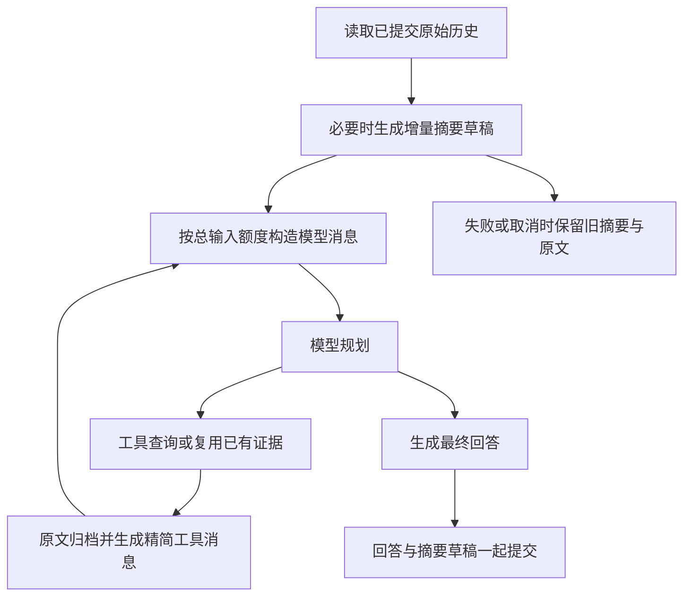

# 上下文管理使用说明

本功能在每次模型调用前构造受预算约束的输入，保留原始历史，精简工具结果，复用证据，并增量总结较早轮次。实施与验收记录见根目录 CONTEXT_MANAGEMENT_CHECKLIST.md。

## 执行路径



原始历史、摘要和模型消息视图分别保存。摘要不会覆盖原文，裁剪仅作用于本次发送的消息；工具完整结果可以通过受账户和会话限制的补读入口读取。

## 模式和启动

默认 `AIROBOT_CONTEXT_MODE=off`。`observe` 保持原模型输入，只记录估计和持久化原始轮次；不调用额外摘要模型。`enforce` 启用工具投影、受限补读、证据复用、历史预算及摘要。

强制模式必须明确配置模型窗口和计数校准文件。未知、过期模型/端点对应关系或缺少校准时，启动检查拒绝开启，不能通过设置模型名假装已验证计数。

```powershell
# 安装新增的显式 Token 计量依赖。
.venv\Scripts\python.exe -m pip install -r requirements-dev.txt

# 使用本地 .env 的模型，合成20个计量请求；不打印密钥。
.venv\Scripts\python.exe scripts/calibrate_context_counter.py

# 先在测试终端启用；窗口大小需根据实际模型核对，32768只是保守实验配置。
$env:AIROBOT_CONTEXT_MODE='enforce'
$env:AIROBOT_CONTEXT_MODEL_WINDOW='32768'
$env:AIROBOT_CONTEXT_CALIBRATION_PATH='eval/reports/context/counter-calibration.json'
.venv\Scripts\python.exe -m uvicorn app.main:app --host 127.0.0.1 --port 8000
```

计数器采用版本化请求序列化和经验保守系数，明确标记 `calibrated-conservative`，不声称是 qwen-plus 原生精确分词。模型别名、端点、编码或序列化方式变化后重新校准；服务商实际用量与估计分别记录。

## 数据与隔离

`data/context.sqlite3` 保存原始已完成轮次、工具原文、摘要版本、证据与执行计量。进程内旧历史在首次启用时幂等导入；已经被旧20轮上限删除的内容无法恢复。

摘要先暂存，当前回答成功时与轮次一起提交；失败、取消不提交半成品。旧有效约束不能因摘要遗漏而消失，撤销必须引用新的用户纠正。摘要连续两次失败时保留旧摘要与原文；必要历史放不下则明确失败。

工具补读需要当前认证账户及会话归属，模型不能指定 owner、任意文件路径或 URL。原始历史和工具记录默认保留，不自动删除；数据库与容量需由部署方监控。本版本仅支持单服务进程会话串行化，多进程部署需增加共享会话锁。

## 接口与指标

聊天 JSON 与 SSE 最终事件增加可选 `context_stats`、`token_usage`。统计包含输入估计、保留/省略轮次、摘要版本、检索请求/执行/复用、工具原文/投影体积、逐调用实际用量、耗时和金额估算。服务商未上报用量时为 null；流式片段数为 `stream_chunks`，不能当作 Token。

Go 验证报告增加 `context_stats`。代码任务继续使用独立任务上下文，保留固定接口和上轮完整必要源码，只压缩重复资料及冗余日志。源码超出预算会返回 `budget_exceeded`，不会截掉源码后宣称完整修复。

普通聊天必须内容超预算时 JSON 返回 HTTP 422、`context_budget_exceeded`；流式入口发送对应 error 事件。HTTP 200 或连接结束不代表业务成功。

## 预算配置

完整配置见 `.env.example` 的上下文管理部分。输入总量包含系统指令、工具定义、历史/摘要、当前问题和工具消息，分项上限不能突破总预算。

历史初始上限6000 Token；长对话试验使用1200 Token校准摘要触发。摘要上限1000、证据总量4000、工具结果1500、补读1000。模型输出普通4096、Go8192，安全余量2048。分项额度与真实模型效果需要通过综合实验选择，不应只按输入长度调整。

## 评测与金额

```powershell
# 无密钥机制测试；Docker用例单独通过显式变量启用。
.venv\Scripts\python.exe -m pytest tests -q

# 真实模型独立运行长对话；每条默认重复1次，最终验收需要显式3次。
.venv\Scripts\python.exe eval/run_context_eval.py --live --group D --split dev --limit 1 --repeats 3

# 仅在地域、模型和调用方式匹配时使用已核对的单价示例。
$env:AIROBOT_CONTEXT_PRICE_BOOK='eval/context_prices.example.json'
```

固定脚本共30条，20开发、10留出，涵盖10/30/60轮。四组为A原流程、B工具与证据、C增加历史预算、D增加摘要。工具数据固定，模型逐轮实际生成；该套终局约束回忆任务的通过率不能代表任意工程任务完成率。

金额按服务商实际用量和配置单价估算，包含摘要、重试及实际发生的Embedding请求；模型/端点/用量不匹配时金额未知。单价示例依据2026-10-14核对的[百炼 qwen-plus 北京在线价格](https://help.aliyun.com/zh/model-studio/qwen-plus)与[text-embedding-v4 北京在线价格](https://help.aliyun.com/zh/model-studio/text-embedding-v4)，不含免费额度、优惠、Batch及显式缓存创建，不等于实际账单。

### 中断后的续跑

`eval/resume_context_eval.py`校验冻结代码、数据、模型及参数，跳过所有完整样本（即使任务未通过），仅重跑中断或尚未执行的样本。原报告不覆盖，新批次原文、文件哈希及费用单独保存。默认只生成计划，不发起模型请求：

```powershell
# 离线检查当前v3矩阵，生成续跑清单；默认新增费用为0。
.venv\Scripts\python.exe eval/resume_context_eval.py
```

账户恢复且累计总预算确定后才增加`--live --max-cost 金额`；金额单位人民币，四组共用，包含未知尝试的预算预留上界。相同输出目录重启会扣除已有续跑用量，不能将每个批次视为新预算。真实执行前还需配置`AIROBOT_CONTEXT_MODEL_WINDOW`、`AIROBOT_CONTEXT_CALIBRATION_PATH`和匹配端点的`AIROBOT_CONTEXT_PRICE_BOOK`，不自动修改.env。

完整任务复用后不再抽样重跑；中断任务使用新会话从第一轮开始。批次意外退出且缺少最终用量结算时停止，保留inflight状态，先核对完整报告再恢复。续跑进度清单不是正式比较报告；原中断开销、未知实际用量和批次间网络/缓存差异必须在最终报告中说明，不能用续跑删除失败记录或自动允许启用。

所有批次结束后，使用独立入口合并报告并比较；合并成本、输入、延迟与摘要统计包含原中断尝试，原始评分不覆盖：

```powershell
# 离线生成四组汇总；存在执行中或未结算批次时拒绝生成。
.venv\Scripts\python.exe eval/merge_context_resume.py

# 所有门槛都满足才返回0；门槛失败返回1，并保留逐项结果。
.venv\Scripts\python.exe eval/compare_context_eval.py --directory eval/reports/context/final-resumed-v3 --output eval/reports/context/final-resumed-v3/comparison.json
```

本次完整对照的结论与限制见 [完整验收结果](context-management-final-results.md)。

## 回退

将 `AIROBOT_CONTEXT_MODE` 改为 `off` 并重启应用，恢复最近6轮输入；已有数据库中的原始轮次可恢复，新摘要不再进入输入。保留数据库与实验报告定位问题。答案缓存按策略版本隔离。

最终是否允许扩大启用范围以 P7 实验报告为准；质量、约束、成本或延迟未达到门槛时保持 off。
