# AI-Robot 架构与流程图

9 个主题、27 张 README 简版图，统一采用 Notion 极简风。每张只展示主链与关键分支；详细条件、异常、阈值和源码位置见对应说明。

直接打开 [图册](index.html) 浏览，或按下方主题阅读。PNG 可直接嵌入 Markdown；SVG 可无损放大，Mermaid 可编辑。

## 整体架构

[SVG](svg/01-architecture-01.svg) · [Mermaid](mermaid/01-architecture-01.mmd) · [完整说明](notes/01-architecture.md)

查看该主题的其他流程

### 索引与存储边界

[SVG](svg/01-architecture-02.svg) · [Mermaid](mermaid/01-architecture-02.mmd)

## 请求生命周期

[SVG](svg/02-request-lifecycle-01.svg) · [Mermaid](mermaid/02-request-lifecycle-01.mmd) · [完整说明](notes/02-request-lifecycle.md)

查看该主题的其他流程

### 普通 JSON 返回

[SVG](svg/02-request-lifecycle-02.svg) · [Mermaid](mermaid/02-request-lifecycle-02.mmd)

### SSE 建立与结束

[SVG](svg/02-request-lifecycle-03.svg) · [Mermaid](mermaid/02-request-lifecycle-03.mmd)

### Go 任务执行与收尾

[SVG](svg/02-request-lifecycle-04.svg) · [Mermaid](mermaid/02-request-lifecycle-04.mmd)

## 普通聊天智能体

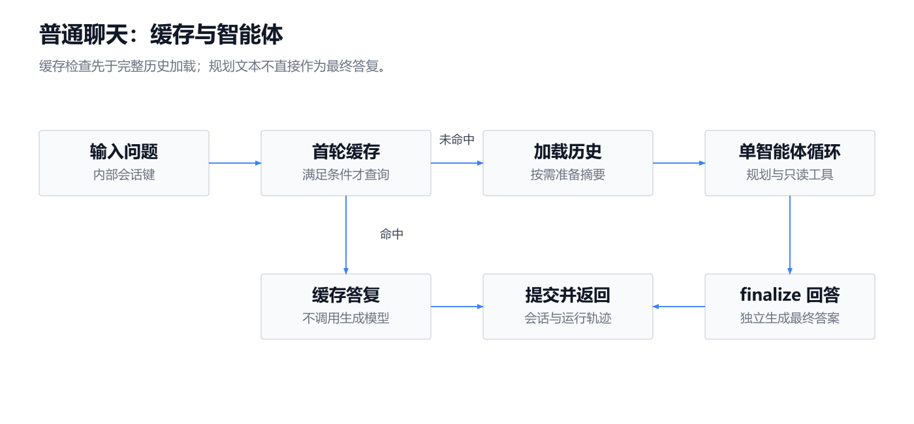

[SVG](svg/03-chat-agent-01.svg) · [Mermaid](mermaid/03-chat-agent-01.mmd) · [完整说明](notes/03-chat-agent.md)

查看该主题的其他流程

### 一轮只读工具调用

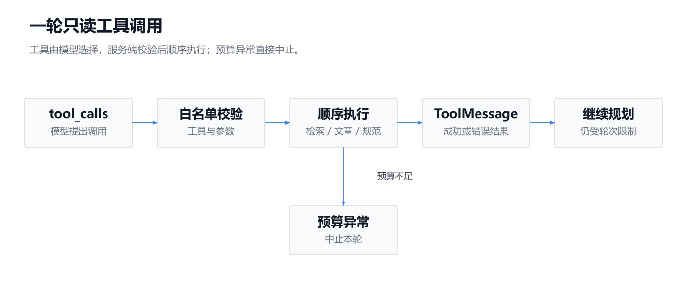

[SVG](svg/03-chat-agent-02.svg) · [Mermaid](mermaid/03-chat-agent-02.mmd)

## 知识入库

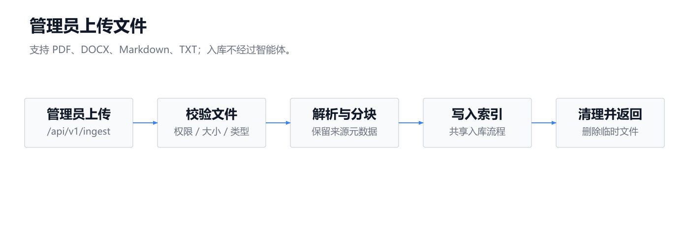

[SVG](svg/04-knowledge-ingestion-01.svg) · [Mermaid](mermaid/04-knowledge-ingestion-01.mmd) · [完整说明](notes/04-knowledge-ingestion.md)

查看该主题的其他流程

### 文章发布事件入库

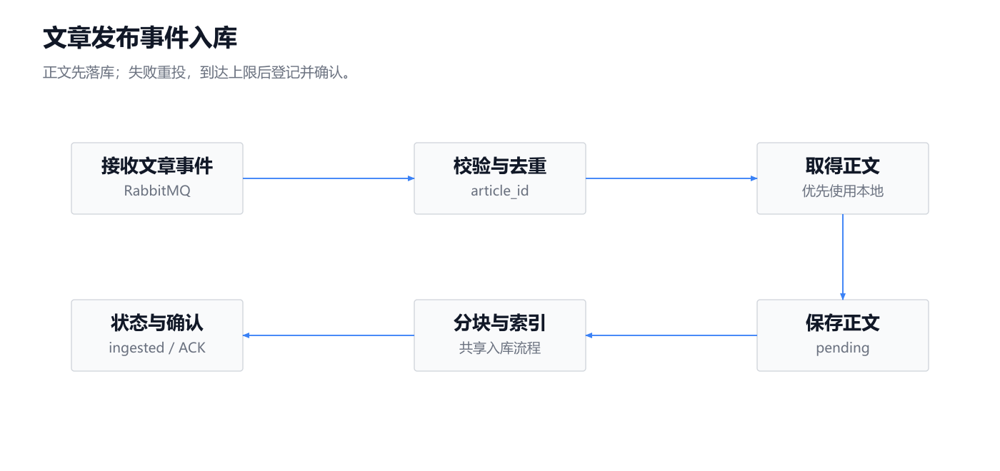

[SVG](svg/04-knowledge-ingestion-02.svg) · [Mermaid](mermaid/04-knowledge-ingestion-02.mmd)

### 启动恢复已有知识

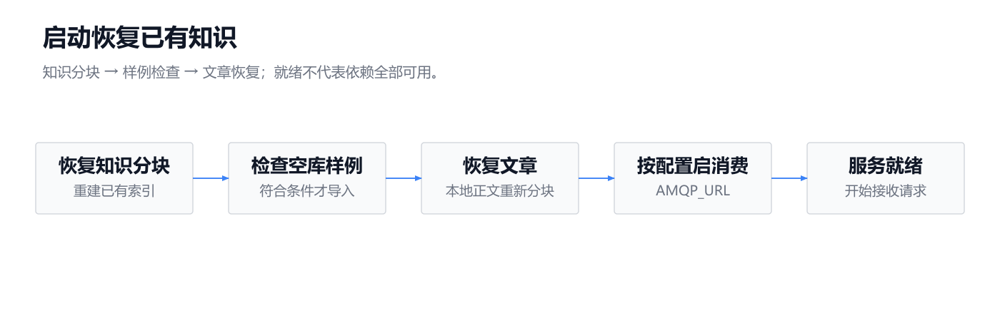

[SVG](svg/04-knowledge-ingestion-03.svg) · [Mermaid](mermaid/04-knowledge-ingestion-03.mmd)

### 共享索引写入顺序

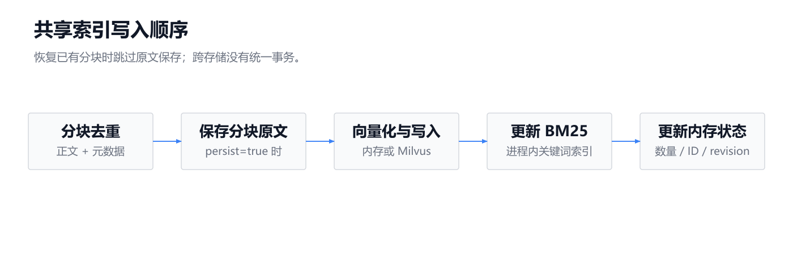

[SVG](svg/04-knowledge-ingestion-04.svg) · [Mermaid](mermaid/04-knowledge-ingestion-04.mmd)

## RAG 检索

[SVG](svg/05-rag-retrieval-01.svg) · [Mermaid](mermaid/05-rag-retrieval-01.mmd) · [完整说明](notes/05-rag-retrieval.md)

查看该主题的其他流程

### 证据返回与最终生成

[SVG](svg/05-rag-retrieval-02.svg) · [Mermaid](mermaid/05-rag-retrieval-02.mmd)

## Go 专用任务编排

[SVG](svg/06-go-orchestration-01.svg) · [Mermaid](mermaid/06-go-orchestration-01.mmd) · [完整说明](notes/06-go-orchestration.md)

查看该主题的其他流程

### 多智能体：两个角色顺序协作

[SVG](svg/06-go-orchestration-02.svg) · [Mermaid](mermaid/06-go-orchestration-02.mmd)

### 服务端成功与修复门禁

[SVG](svg/06-go-orchestration-03.svg) · [Mermaid](mermaid/06-go-orchestration-03.mmd)

## Go 沙箱验证

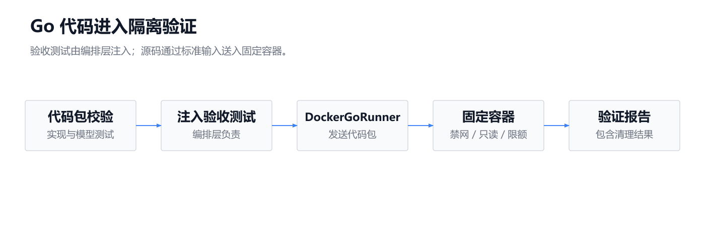

[SVG](svg/07-go-sandbox-01.svg) · [Mermaid](mermaid/07-go-sandbox-01.mmd) · [完整说明](notes/07-go-sandbox.md)

查看该主题的其他流程

### 容器内的四阶段检查

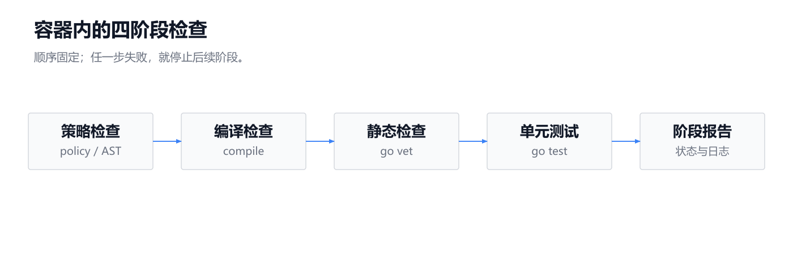

[SVG](svg/07-go-sandbox-02.svg) · [Mermaid](mermaid/07-go-sandbox-02.mmd)

### 验证结束后的资源清理

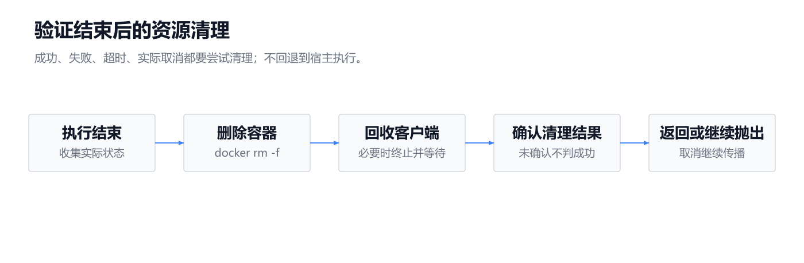

[SVG](svg/07-go-sandbox-03.svg) · [Mermaid](mermaid/07-go-sandbox-03.mmd)

## 上下文管理

[SVG](svg/08-context-management-01.svg) · [Mermaid](mermaid/08-context-management-01.mmd) · [完整说明](notes/08-context-management.md)

查看该主题的其他流程

### 摘要与模型输入预算

[SVG](svg/08-context-management-02.svg) · [Mermaid](mermaid/08-context-management-02.mmd)

### 工具结果精简与证据复用

[SVG](svg/08-context-management-03.svg) · [Mermaid](mermaid/08-context-management-03.mmd)

### 按需补读完整工具结果

[SVG](svg/08-context-management-04.svg) · [Mermaid](mermaid/08-context-management-04.mmd)

## 验证、评测与功能启用

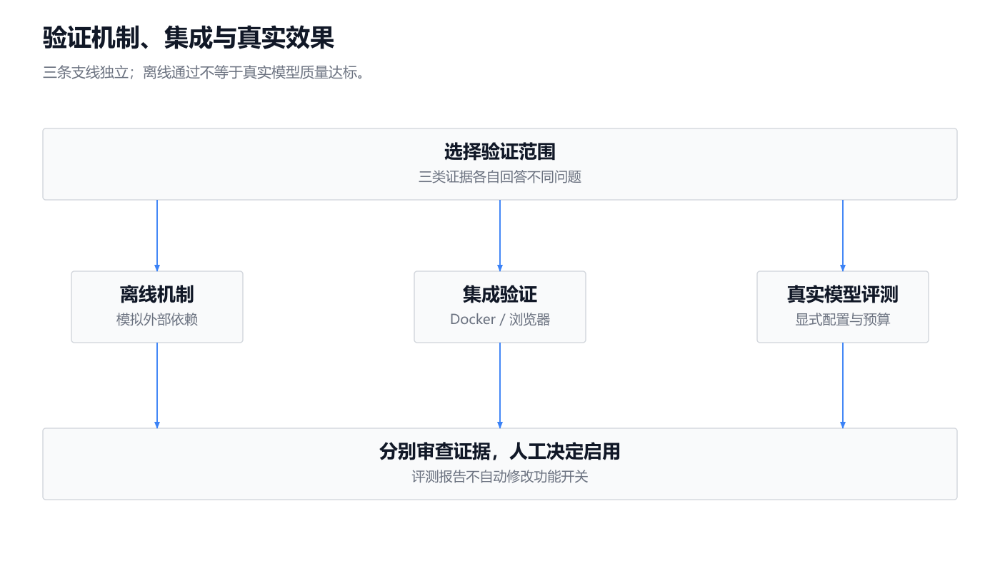

[SVG](svg/09-verification-evaluation-01.svg) · [Mermaid](mermaid/09-verification-evaluation-01.mmd) · [完整说明](notes/09-verification-evaluation.md)

查看该主题的其他流程

### Go 多智能体对照评测

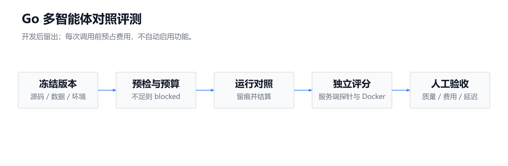

[SVG](svg/09-verification-evaluation-02.svg) · [Mermaid](mermaid/09-verification-evaluation-02.mmd)

### 上下文四组对照与验收

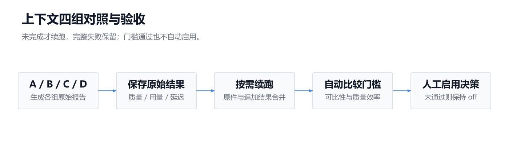

[SVG](svg/09-verification-evaluation-03.svg) · [Mermaid](mermaid/09-verification-evaluation-03.mmd)

## 编辑与重新生成

- `readme_specs.py`：27 张简版图的节点、连接和布局。
- `notes/`：原始完整说明；默认展示新图，原 Mermaid 流程折叠保留。
- `render.cjs`：本地批量生成 SVG、PNG、缩略图和图册。
- `svg-validation.json`、`render-report.json`：构图与导出检查结果。

使用 Node.js 运行 `render.cjs`。可通过 `DIAGRAM_PYTHON`、`DIAGRAM_RUNTIME_MODULES`、`DIAGRAM_FONT`、`FIREWORKS_SKILL_ROOT` 指定本机依赖。

本目录是技术文档图示，不代表当前运行环境已启用可选功能，也不将历史评测结果视为当前版本认证。
