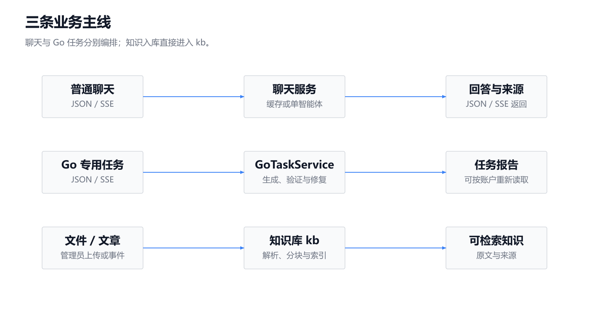
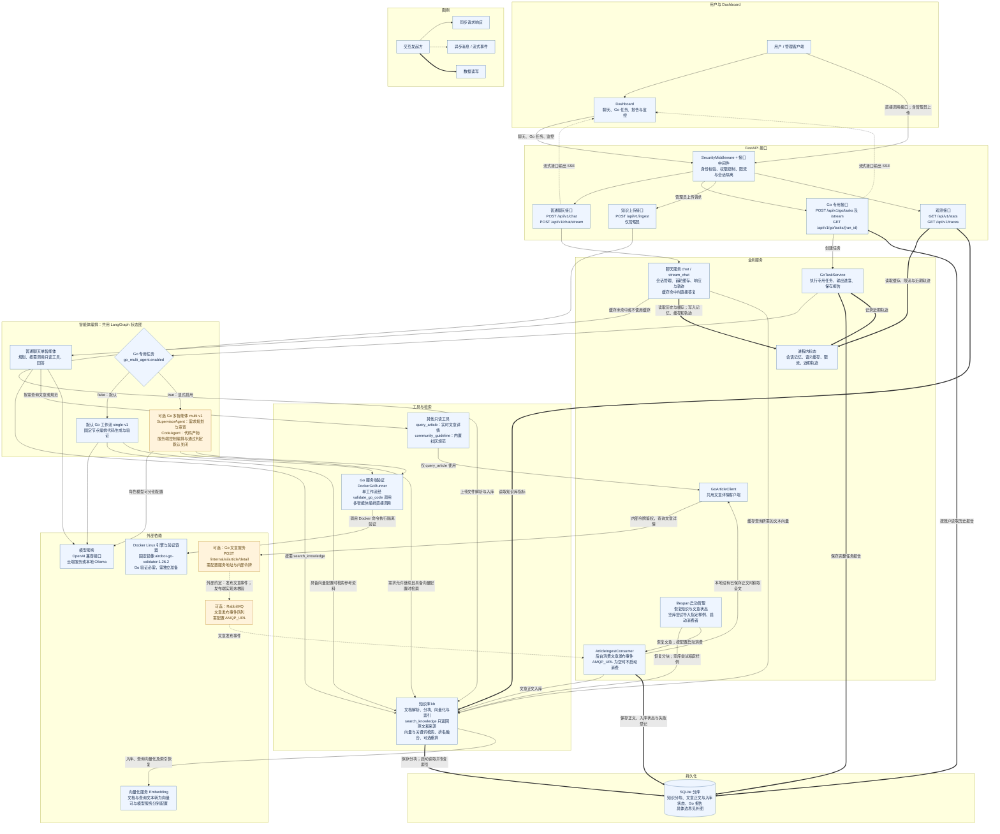
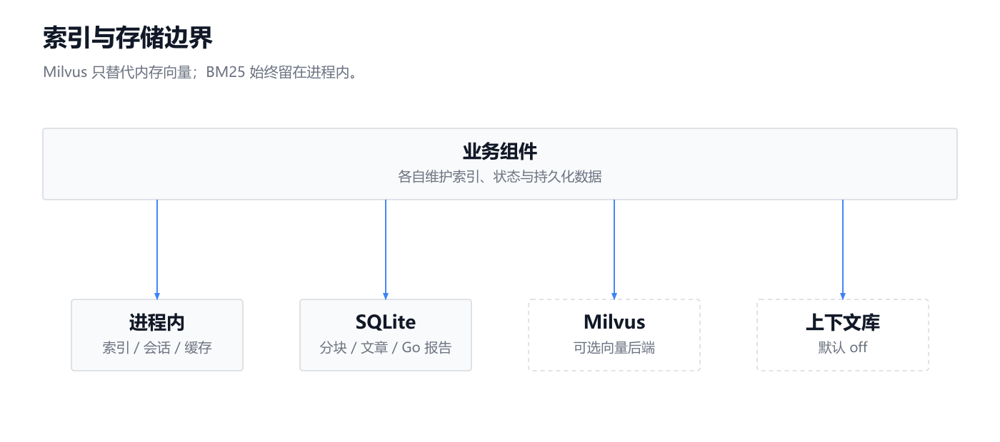
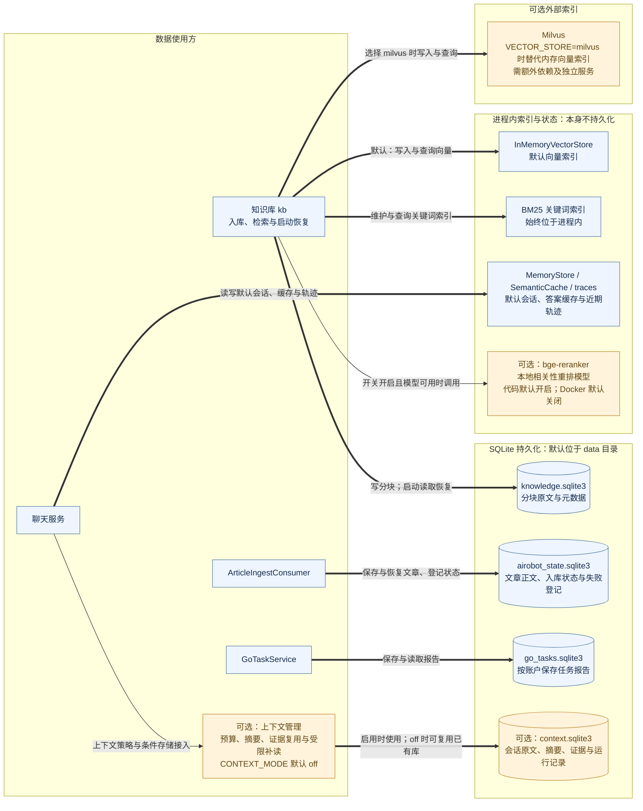

这是基于当前源码的整体架构图：普通聊天使用单智能体，Go 专用任务按开关选择编排方式，知识入库直接进入知识库。

已读取项目说明及相关实现，未修改代码、未读取 `.env`。以下“默认”指代码或部署文件的默认值，不代表当前进程配置或依赖已就绪。

---

主图展示七层组件及三条主链路。实线表示请求响应调用，包括代码通过 `async/await` 实现的调用；虚线表示异步消息或 SSE（服务端事件流）；粗线表示数据读写。

<!-- readme-diagram:01-architecture-01 -->

展开原始完整流程

---

补图细化索引与存储边界，避免把内存索引、会话缓存误画成持久化数据库。重复的组件 ID 对应主图中的同一组件。

<!-- readme-diagram:01-architecture-02 -->

展开原始完整流程

---

关键分支与对应源码：

| 分支或边界 | 实际逻辑 | 源码位置 |
|---|---|---|
| 普通聊天 | 缓存命中直接返回；否则进入单智能体，按需调用只读工具。不会因问题涉及 Go 就切换专用任务 | [chat.py:137](../../../app/services/chat.py#L137)、[graph.py:272](../../../app/agents/graph.py#L272)、[tools.py:104](../../../app/agents/tools.py#L104) |
| Go 专用任务 | 默认 `single-v1`；`AIROBOT_GO_MULTI_AGENT_ENABLED=true` 才进入 `multi-v1`。报告可以重新读取，未实现任务恢复执行 | [config.py:30](../../../app/config.py#L30)、[service.py:76](../../../app/go_validation/service.py#L76)、[go_workflow.py:537](../../../app/agents/go_workflow.py#L537)、[store.py:42](../../../app/go_validation/store.py#L42) |
| 知识入库 | 上传直接调用 `kb.ingest_file`；启动只在空库时尝试指定样例，不扫描整个 `data` 目录 | [main.py:36](../../../app/main.py#L36)、[main.py:153](../../../app/main.py#L153)、[retriever.py:266](../../../app/rag/retriever.py#L266) |
| 文章事件与实时查询 | 共用 Go 客户端；`AMQP_URL` 为空时不启动消费者。发布端属于外部服务，本仓库无法核验其实现；未实现历史文章主动回填及更新、删除同步 | [article_consumer.py:173](../../../app/services/article_consumer.py#L173)、[article_consumer.py:259](../../../app/services/article_consumer.py#L259)、[go_client.py:62](../../../app/services/go_client.py#L62)、[usage.md](../../usage.md) |
| 检索与重排 | 混合检索默认开启；向量后端默认 `inmemory`，Milvus 可选。重排代码默认开启，但需要额外依赖和模型，加载失败时跳过；Docker 默认关闭 | [config.py:152](../../../app/config.py#L152)、[retriever.py:71](../../../app/rag/retriever.py#L71)、[retriever.py:275](../../../app/rag/retriever.py#L275)、[reranker.py:21](../../../app/rag/reranker.py#L21)、[docker-compose.yml:20](../../../docker-compose.yml#L20) |
| 持久化与上下文 | 默认会话、缓存、轨迹在内存；知识原文和 Go 报告有独立持久化。实验上下文策略默认 `off`；关闭后仍可能复用已有上下文库 | [retriever.py:133](../../../app/rag/retriever.py#L133)、[memory.py:15](../../../app/services/memory.py#L15)、[config.py:130](../../../app/config.py#L130)、[session.py:9](../../../app/context/session.py#L9) |
| Docker 连接 | Go 验证必须通过固定容器执行，容器禁网；默认 Compose 只部署应用与 Ollama，未配备应用调用 Docker 所需的客户端和引擎连接，也未部署 Go 服务或 RabbitMQ；Milvus 使用独立 Compose 文件 | [runner.py:23](../../../app/go_validation/runner.py#L23)、[Dockerfile:25](../../../Dockerfile#L25)、[docker-compose.yml:7](../../../docker-compose.yml#L7)、[docker-compose-milvus.yml:6](../../../docker-compose-milvus.yml#L6) |

Dashboard 实际调用聊天、Go 任务和监控接口，没有知识上传界面；文章工具也没有发布、评论或修改文章的写入能力。对应实现见 [dashboard.html:529](../../../app/static/dashboard.html#L529) 和 [tools.py](../../../app/agents/tools.py)。
