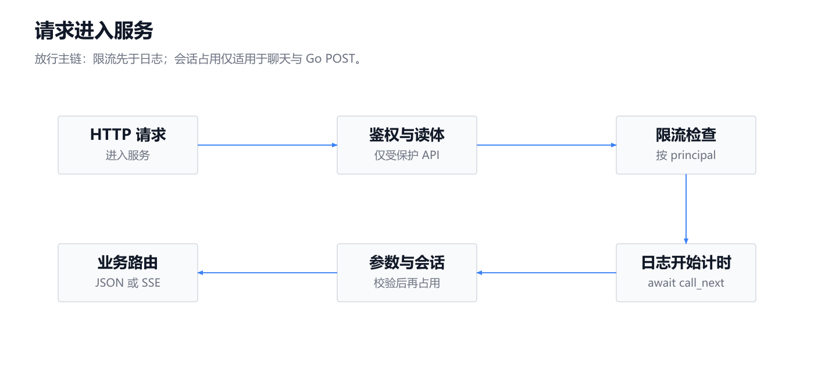
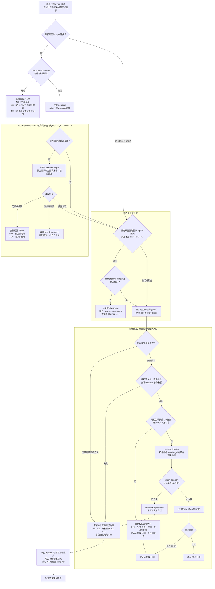
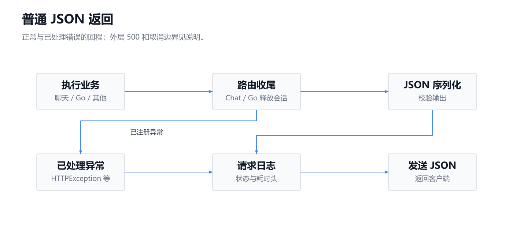
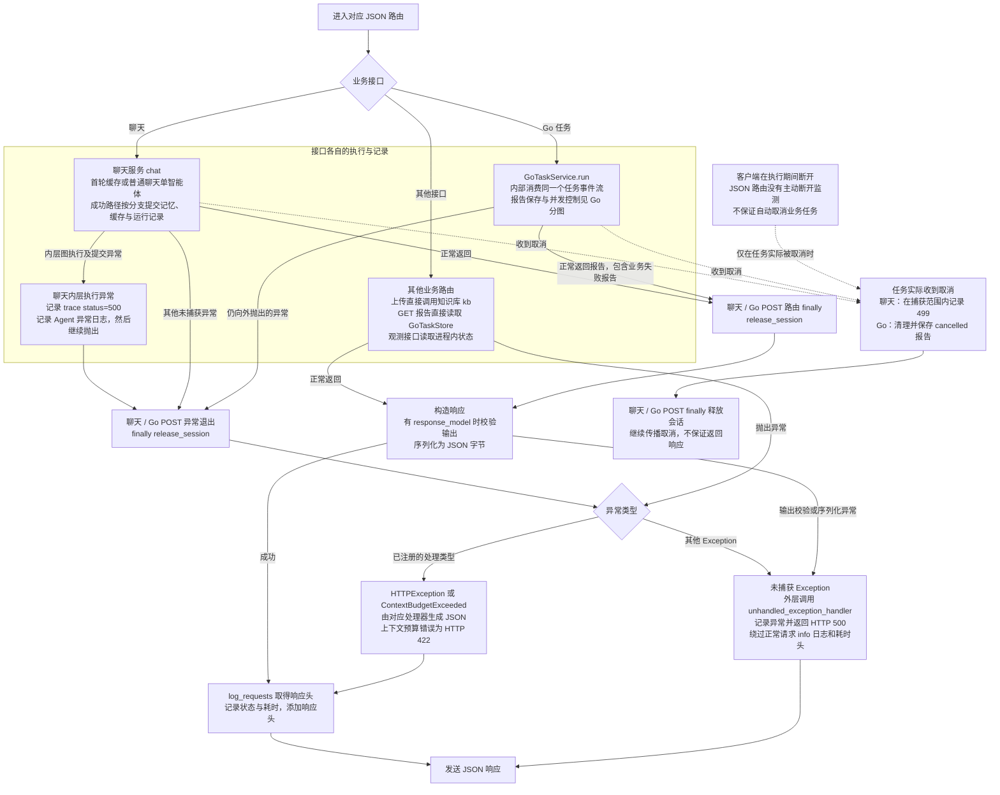
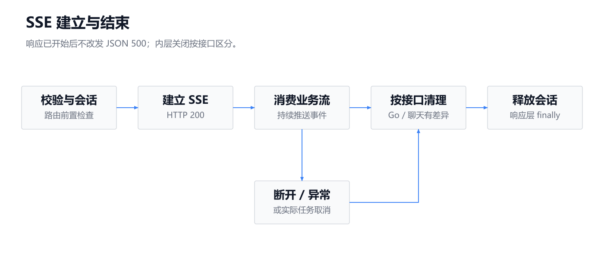
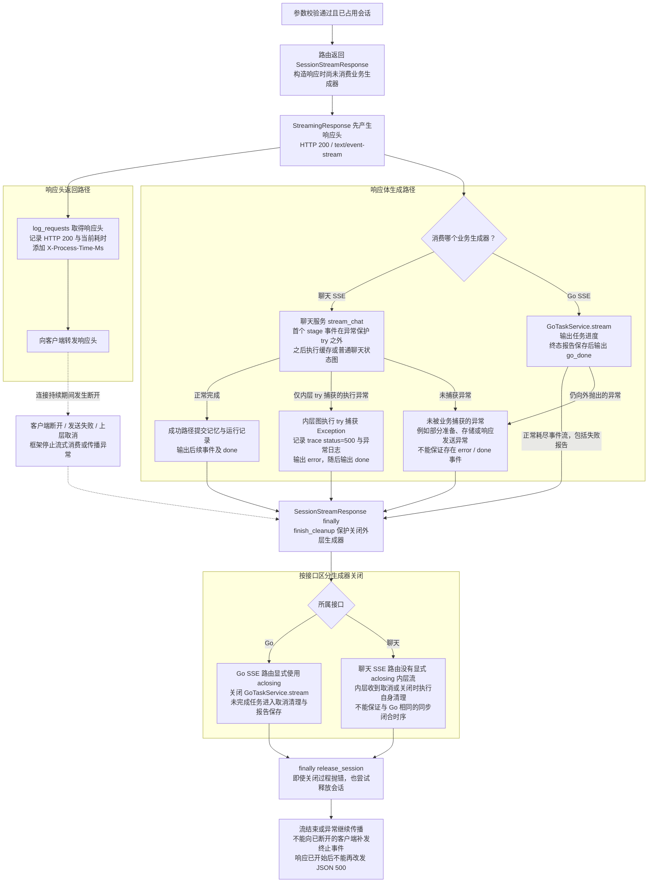
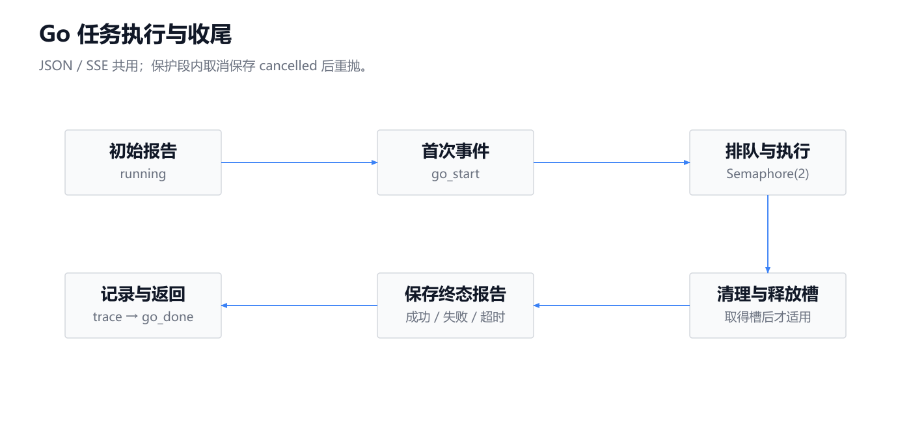
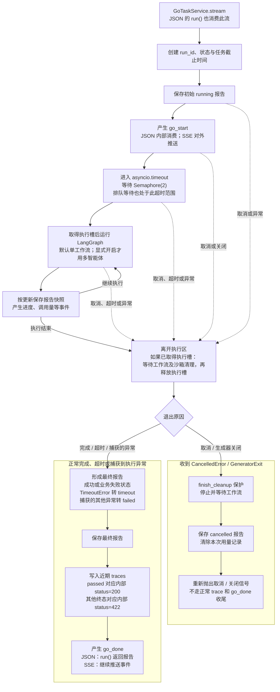

这组生命周期图按源码区分入口门禁、业务执行和响应发送，并以 **SSE 响应头是否已经产生**划分错误处理边界。

先修正上一张架构图的两处表述：

- 会话占用控制只适用于聊天、Go 任务的四个 POST 接口；Go 的 `Semaphore(2)`（最多同时执行两个任务）属于 `GoTaskService`，其他接口不共享。
- 补图中 `GoTaskService` 的“保存与读取报告”应改为“保存报告”；GET 报告接口直接读取 `GoTaskStore`。

全程只读源码，未读取 `.env`、未修改代码。以下实线表示处理顺序，虚线表示事件或取消信号，粗线表示数据写入。

---

**入口图：先鉴权、读取受限请求体、限流，再开始请求日志计时。**

<!-- readme-diagram:02-request-lifecycle-01 -->

展开原始完整流程

这里的限流按 `principal` 执行：管理员共用 `admin` 额度，可信网关按账号区分，**不是按客户端 IP**。身份拒绝、请求体拒绝、限流拒绝均绕过 `log_requests`，因此没有它生成的 info 日志和耗时响应头；限流分支另有 warning 和轨迹记录。

---

**JSON 图：业务完成或抛错后，才构建普通响应。**

<!-- readme-diagram:02-request-lifecycle-02 -->

展开原始完整流程

上传接口没有会话占用或统一业务轨迹：文件校验失败返回相应错误；入库异常被转换成 `HTTPException(500)`，临时文件在 `finally` 删除。它属于**已处理的 HTTP 错误**，仍会经过正常请求日志。

---

**SSE 图：响应头先产生，再消费生成器；业务失败通常无法改变 HTTP 200。**

<!-- readme-diagram:02-request-lifecycle-03 -->

展开原始完整流程

在 SSE 响应建立前，鉴权、限流、参数校验和会话冲突仍返回普通 JSON 错误。建立后，聊天内层异常通过事件表达；Go 任务通过报告终态表达。逃逸到框架的异常只能记录、传播并终止流，不能统一转换为第二个 JSON 响应。

聊天 `stream_chat` 在捕获范围内收到 `CancelledError` 或 `GeneratorExit` 时记录内部 `499`，随后重新抛出；**首个 `stage` 事件在该保护范围之外，不能保证所有早期断开都有 499 记录。**

---

**Go 分图：JSON 与 SSE 共用同一个任务执行流，但只有 SSE 向客户端逐条推送事件。**

<!-- readme-diagram:02-request-lifecycle-04 -->

展开原始完整流程

Go 的执行槽在工作流清理后释放；取消报告保存完成后，路由才继续释放会话占用。两者不是同一把锁。`run_blocking` 用线程执行阻塞操作并处理取消等待，`finish_cleanup` 进一步保护清理过程免受重复取消中断。

---

**HTTP 状态、请求日志和运行记录是三套不同信息，不能互相替代。**

| 情况 | HTTP / 事件表现 | 日志与运行记录 |
|---|---|---|
| 未授权、权限不足、请求体拒绝 | 普通 JSON 错误 | 不进入 `log_requests`；没有统一业务 trace |
| 限流 | HTTP 429 | 单独 warning、trace 429；没有正常请求 info 日志 |
| 参数错误、会话冲突 | HTTP 422 / 409 | 有请求 info 日志；通常没有业务 trace |
| 聊天内层执行异常 | JSON 通常为 500；上下文预算错误为 422 | 内层异常记录 trace 500，可能与 HTTP 状态不同 |
| 聊天 SSE 内层异常 | HTTP 200，`error` 后接 `done` | 请求日志为 200，业务 trace 为 500 |
| Go 任务未通过或超时 | 通常仍为 HTTP 200；报告包含失败终态 | 正常收尾时业务 trace 为 422 |
| Go 任务取消 | 不保证响应或终止事件送达 | 保存 `cancelled` 报告；取消分支不追加正常终态 trace |
| 上传、GET 报告、观测接口 | 各路由自己的响应 | 没有聊天/Go POST 的会话占用与统一执行记录 |

对应源码位置：

| 内容 | 源码 |
|---|---|
| 身份、权限、请求体限制 | [security.py:20](../../../app/services/security.py#L20)、[security.py:48](../../../app/services/security.py#L48) |
| 限流与请求日志 | [main.py:73](../../../app/main.py#L73)、[main.py:84](../../../app/main.py#L84) |
| 异常处理器 | [main.py:99](../../../app/main.py#L99)、[main.py:105](../../../app/main.py#L105) |
| 四个 POST 路由与报告读取 | [main.py:193](../../../app/main.py#L193)、[main.py:208](../../../app/main.py#L208)、[main.py:223](../../../app/main.py#L223)、[main.py:234](../../../app/main.py#L234)、[main.py:247](../../../app/main.py#L247) |
| 会话占用、流结束清理 | [security.py:92](../../../app/services/security.py#L92)、[security.py:107](../../../app/services/security.py#L107) |
| 聊天执行、错误与轨迹 | [chat.py:137](../../../app/services/chat.py#L137)、[chat.py:219](../../../app/services/chat.py#L219) |
| Go 并发、报告、取消处理 | [service.py:43](../../../app/go_validation/service.py#L43)、[service.py:76](../../../app/go_validation/service.py#L76)、[service.py:127](../../../app/go_validation/service.py#L127) |
| 线程等待与取消保护 | [concurrency.py:6](../../../app/services/concurrency.py#L6)、[concurrency.py:29](../../../app/services/concurrency.py#L29) |
| 中间件顺序、响应头和流式机制的本地依赖依据 | applications.py:1054（本地参考：`.venv/Lib/site-packages/fastapi/applications.py:1054`）、applications.py:104（本地参考：`.venv/Lib/site-packages/starlette/applications.py:104`）、base.py:112（本地参考：`.venv/Lib/site-packages/starlette/middleware/base.py:112`）、responses.py:250（本地参考：`.venv/Lib/site-packages/starlette/responses.py:250`） |
