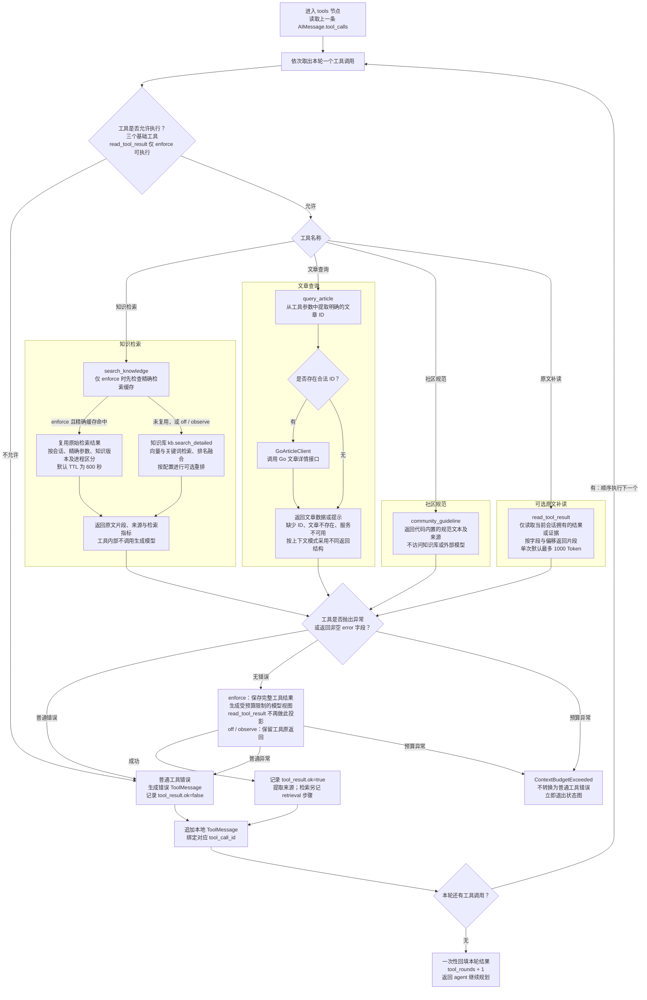

普通聊天通过**单智能体反复调用只读工具，再由 `finalize` 独立生成回答**；不会自动进入 Go 专用工作流或多智能体。

以下按当前源码及代码默认值绘制，未读取 `.env`、未修改代码。拆为主流程和工具子流程，实线表示执行顺序，粗线表示数据保存。

---

**主流程：缓存检查先于完整历史加载，规划文本不直接作为最终回答。**

```mermaid
flowchart TB
    subgraph service_prepare["聊天服务：接收与准备"]
        chat_entry["接收问题与内部会话键<br/>chat 或 stream_chat<br/>创建 run_id 与运行记录"]
        model_config{"是否配置 LLM_API_KEY？"}
        no_model["记录 no-key<br/>直接返回缺少模型配置提示<br/>不查缓存、不执行智能体、不保存本轮会话"]

        cache_condition{"允许查答案缓存？<br/>cache_enabled=true<br/>已配置 Embedding<br/>内存及可用会话库均无历史"}
        cache_lookup["查询文本向量化<br/>SemanticCache 查找答案<br/>按身份命名空间、上下文模式与知识版本隔离"]
        cache_hit{"双门限命中？<br/>向量相似度默认 ≥ 0.75<br/>词面重叠默认 ≥ 0.5"}
        cached_result["复用答案与来源<br/>cache_hit=true<br/>跳过历史构建、状态图和生成模型"]

        history_load["context_session.prepare / history<br/>加载历史；默认取最近 6 轮<br/>上下文模式差异见下表"]
        initial_state["构造 AgentState<br/>历史消息 + 本轮 HumanMessage<br/>tool_rounds=0，sources/steps 为空<br/>不设置 go_request"]
        summary_prepare["按条件准备会话摘要<br/>仅 enforce 且历史、摘要开关均开启<br/>达到阈值时才额外调用摘要模型"]
    end

    subgraph orchestration_layer["普通聊天单智能体：LangGraph 状态图"]
        graph_start["START → agent<br/>没有 go_request，固定进入普通聊天分支"]
        round_limit{"tool_rounds 是否达到<br/>agent_max_tool_rounds？<br/>默认 4"}
        forced_finish["服务端写入完成标记<br/>跳过本次规划模型调用"]
        bind_tools["绑定三个只读工具<br/>仅 enforce 且存在补读线索时<br/>额外提供 read_tool_result"]
        planning_context["构建规划上下文 build<br/>系统规则 + 规划提示 + 消息 + 工具定义<br/>off / observe / enforce"]
        planning_model["调用规划模型 usage.invoke<br/>JSON 与 SSE 均使用此非流式调用"]
        tool_decision{"响应是否包含 tool_calls？<br/>不以文本是否等于“完成”判断"}
        tools_node["tools 节点：执行本轮工具<br/>详见工具子图"]
        tool_feedback["回填 ToolMessage、来源与步骤<br/>全部工具处理完后 tool_rounds + 1"]

        finalize_prepare["finalize<br/>移除最后一条无工具调用的规划消息<br/>重新构建最终回答上下文<br/>使用未绑定工具的模型"]
        output_mode{"是否为 SSE？"}
        final_json["usage.invoke<br/>一次取得最终回答"]
        final_sse["usage.stream<br/>推送最终回答的 token 事件<br/>流式生成不做应用层重试"]
        final_content{"最终文本是否非空？"}
        graph_end["写入 final → END"]
        graph_error["异常退出状态图<br/>包括预算不足、模型异常或最终文本为空<br/>沿用 JSON / SSE 各自异常处理"]
    end

    subgraph service_finish["聊天服务：结果与保存"]
        result_pack["整理结果<br/>提取 reply，来源去重<br/>保留 steps、run_id 与用量"]
        session_commit["context_session.commit<br/>有可用存储时提交本轮原文及摘要草稿"]
        memory_save["memory.add<br/>保存用户问题与最终回答<br/>默认最多保留 20 轮"]
        cache_write{"是否写入答案缓存？<br/>本次不是缓存命中<br/>查询向量存在<br/>全部工具均为成功的 search_knowledge<br/>来源非空、调用与结果数量一致<br/>知识版本未变化"}
        cache_save["SemanticCache.put<br/>保存答案、来源等结果"]
        trace_save["记录运行用量与 traces<br/>上下文模式非 off 时另存运行记录<br/>清除本次临时计量"]
        response_out["JSON：返回完整结果<br/>SSE：发送终止事件 done<br/>非缓存 SSE 此前已持续推送最终文本"]
    end

    chat_entry --> model_config
    model_config -->|"否"| no_model
    no_model --> response_out
    model_config -->|"是"| cache_condition
    cache_condition -->|"满足"| cache_lookup
    cache_condition -->|"不满足"| history_load
    cache_lookup -->|"查询成功"| cache_hit
    cache_lookup -->|"向量化或缓存查找异常：告警后继续"| history_load
    cache_hit -->|"命中"| cached_result
    cache_hit -->|"未命中"| history_load

    %% 缓存命中仍保存本轮会话，但不重新写入答案缓存。
    cached_result --> session_commit
    history_load --> initial_state
    initial_state --> summary_prepare
    summary_prepare --> graph_start

    %% 普通聊天即使启用 Go 多智能体配置，也不会因问题内容自动跳转。
    graph_start --> round_limit
    round_limit -->|"达到上限"| forced_finish
    forced_finish --> finalize_prepare
    round_limit -->|"未达到"| bind_tools
    bind_tools --> planning_context
    planning_context --> planning_model
    planning_model --> tool_decision
    tool_decision -->|"有工具调用"| tools_node
    tools_node --> tool_feedback
    tool_feedback --> round_limit
    tool_decision -->|"没有工具调用"| finalize_prepare

    %% 最终回答单独调用模型，不直接采用规划阶段的文本。
    finalize_prepare --> output_mode
    output_mode -->|"否"| final_json
    output_mode -->|"是"| final_sse
    final_json --> final_content
    final_sse --> final_content
    final_content -->|"非空"| graph_end
    final_content -->|"为空"| graph_error
    planning_context -->|"构建失败"| graph_error
    planning_model -->|"调用失败"| graph_error
    finalize_prepare -->|"构建失败"| graph_error
    final_json -->|"调用失败"| graph_error
    final_sse -->|"生成失败"| graph_error
    tools_node -->|"ContextBudgetExceeded 直接上抛"| graph_error

    graph_end --> result_pack
    result_pack --> session_commit
    session_commit ==> memory_save
    memory_save --> cache_write
    cache_write -->|"满足全部条件"| cache_save
    cache_write -->|"不满足"| trace_save
    cache_save ==> trace_save
    trace_save --> response_out
```

<!-- readme-diagram:03-chat-agent-01 -->

展开原始完整流程

缓存门禁中的“无历史”会检查内存以及可用的上下文数据库，不只是查看请求是否携带 `session_id`。缓存按认证身份共享命名空间，**不是每个会话各自独立一份**；命中仍需先完成查询向量化，但不调用生成模型。

对应实现：[chat.py:40](../../../app/services/chat.py#L40)、[chat.py:64](../../../app/services/chat.py#L64)、[chat.py:98](../../../app/services/chat.py#L98)、[semantic_cache.py:54](../../../app/services/semantic_cache.py#L54)。

---

**工具子流程：模型选择工具，服务端校验并顺序执行，每轮可以包含多个调用。**

<!-- readme-diagram:03-chat-agent-02 -->

展开原始完整流程

工具选择来自模型返回的 `tool_calls`，不是服务端按问题关键词强制分流。文章工具内部会解析文章 ID；知识检索不会固定发生在每次聊天中。

`off/observe` 下，文章服务不可用可能被工具转成普通提示文本，因此 `tool_result.ok=true` **不等于文章服务查询成功**。`enforce` 下该错误返回显式 `error`，会进入工具失败分支。

对应实现：[graph.py:163](../../../app/agents/graph.py#L163)、[tools.py:104](../../../app/agents/tools.py#L104)、[tools.py:110](../../../app/agents/tools.py#L110)、[tools.py:128](../../../app/agents/tools.py#L128)、[evidence.py:23](../../../app/context/evidence.py#L23)。

---

**上下文管理默认关闭；三种模式的行为不同。**

| 项目 | `off`：默认 | `observe` | `enforce` |
|---|---|---|---|
| 历史加载 | 内存最近 6 轮；内存为空时可从已有库恢复 | 优先使用持久化历史最近 6 轮 | 历史功能开启时读取未被摘要覆盖的历史，再按预算选择；关闭时采用最近轮次 |
| 模型输入构建 | 系统消息直接拼接原消息 | 计量后保留原输入 | 构造临时视图，校验工具协议、历史、摘要和证据预算 |
| 增量摘要 | 不生成 | 不生成 | 还需历史、摘要开关均开启并达到触发阈值 |
| 工具结果 | 保留原返回 | 保留原返回 | 保存完整结果，向模型提供受额度限制的结果视图 |
| 检索复用与原文补读 | 不启用 | 不启用 | 启用精确检索复用；存在补读线索时向模型提供补读工具 |
| 会话持久化 | 默认不创建库；存在已有库时可继续提交原文 | 提交原文与运行记录 | 提交原文、摘要等上下文数据及运行记录 |

`off` 仍有模型用量计量，不表示完全不计量。摘要是本轮成功后的提交草稿；摘要生成失败会保留原状态，后续构建器再判断原始历史能否放进预算。

对应实现：[session.py:9](../../../app/context/session.py#L9)、[session.py:40](../../../app/context/session.py#L40)、[builder.py:43](../../../app/context/builder.py#L43)、[summary.py:110](../../../app/context/summary.py#L110)、[tool_projection.py:43](../../../app/context/tool_projection.py#L43)。

---

**实际限制与退出条件：**

| 限制或条件 | 源码实际行为 |
|---|---|
| 工具轮次 | 默认最多 **4 轮**；整批工具执行完只增加一次轮次，单轮没有额外的工具数量上限 |
| 达到轮次上限 | 不再调用规划模型，服务端产生完成标记，仍进入最终回答模型 |
| 模型主动结束 | 规划响应没有 `tool_calls` 即进入最终回答；不要求文本必须为“完成” |
| 模型调用次数 | 按默认分支推导，主流程最多 **4 次规划调用＋1 次最终生成**；摘要与重试另计，不是共享总调用额度 |
| 非流式模型重试 | 可重试错误默认最多尝试 **3 次，含首次**；SDK 隐式重试关闭 |
| SSE 生成 | 规划仍为非流式调用；只有 `finalize` 推送回答文本，最终流式调用不做应用层重试 |
| 摘要调用 | 满足启用与触发条件后，每个运行最多尝试 **2 次**，单次默认超时 **30 秒** |
| 强制上下文预算 | 需要足够的模型窗口及匹配模型、端点的已校准计数器；不满足时启动校验失败或执行抛错 |
| 默认 Token（模型文本计量单位）额度 | 输入上限 16000，并受窗口剩余额度约束；输出预留 4096，安全预留 2048；工具结果 1500、补读结果 1000、可见证据总额 4000 |
| 普通工具失败 | 写入错误 `ToolMessage` 后继续本轮及后续规划；预算异常直接上抛 |
| 最终回答为空 | 抛出异常，退出成功路径；不会自动切换 Go 流程或其他智能体 |

上述规则主要位于 [graph.py:132](../../../app/agents/graph.py#L132)、[graph.py:224](../../../app/agents/graph.py#L224)、[graph.py:231](../../../app/agents/graph.py#L231)、[config.py:120](../../../app/config.py#L120)、[usage.py:138](../../../app/context/usage.py#L138)、[budget.py:8](../../../app/context/budget.py#L8)。

“优先检索”“不要伪造事实”“遵守用户字数要求”属于提示词约束；工具白名单、轮次检查、未绑定工具的最终生成，以及 `enforce` 模式的预算校验属于代码执行边界。
