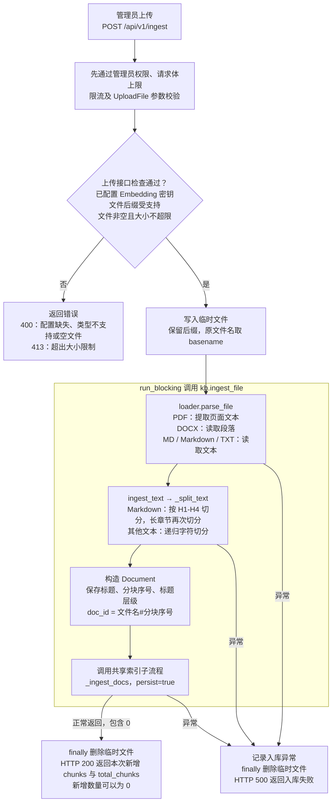
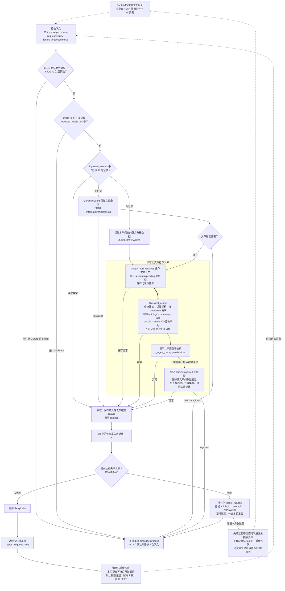
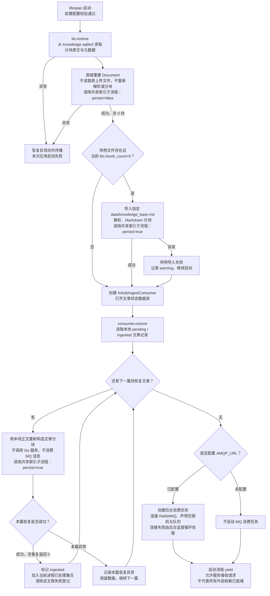
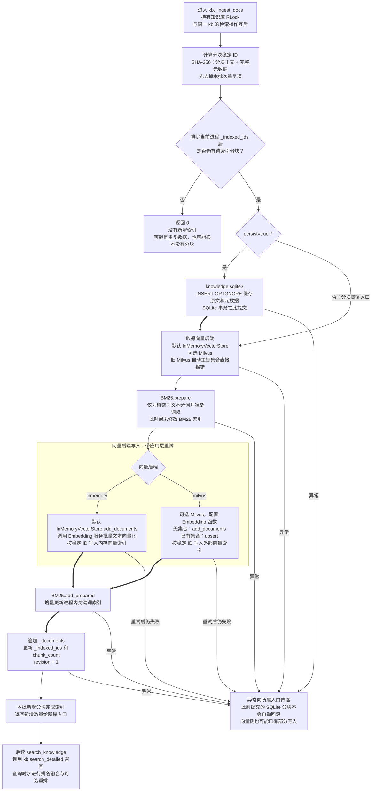

知识入库有三个独立入口：**文件上传负责解析新文件，文章事件负责获取并保存正文，启动恢复负责重建已有数据的索引**；它们只在分块进入 `_ingest_docs` 后共享索引写入流程。

以下按当前源码绘制，未读取 `.env`、未修改代码。实线表示执行顺序，虚线表示消息投递或重投，粗线表示数据保存。

---

**入口一：管理员上传文件。**

<!-- readme-diagram:04-knowledge-ingestion-01 -->

展开原始完整流程

支持 `.pdf`、`.docx`、`.md`、`.markdown`、`.txt`，不支持旧版 `.doc`。文件内容默认上限 **10 MiB**，整个上传请求另允许 **64 KiB** 的表单开销。

普通递归切分默认长度 **400 字符**、重叠 **80 字符**；Markdown 章节超过默认 **800 字符**才进一步递归切分。PDF 当前只提取文本，没有 OCR（图片文字识别）流程。

源码：[main.py:153](../../../app/main.py#L153)、[loader.py:9](../../../app/rag/loader.py#L9)、[retriever.py:205](../../../app/rag/retriever.py#L205)、[retriever.py:249](../../../app/rag/retriever.py#L249)。

---

**入口二：RabbitMQ 文章事件。正文先落库，再进入知识索引流程。**

<!-- readme-diagram:04-knowledge-ingestion-02 -->

展开原始完整流程

这里的 ACK（消息确认）**不等于成功入库**：非法消息、重复文章、404，以及达到失败上限后，都会正常结束并 ACK。代码没有把这些失败消息转入死信队列。

失败次数保存在进程内，重启后重新计数；`event_id` 用于日志和失败登记，实际重复判断依据是 `article_id`。图中的确认和拒绝动作以消息通道可用为前提，连接中断时不能保证确认已经送达。

源码：[article_consumer.py:95](../../../app/services/article_consumer.py#L95)、[article_consumer.py:202](../../../app/services/article_consumer.py#L202)、[article_consumer.py:228](../../../app/services/article_consumer.py#L228)、[article_consumer.py:259](../../../app/services/article_consumer.py#L259)。ACK／拒绝行为另核对了本地依赖：message.py:567（本地参考：`.venv/Lib/site-packages/aio_pika/message.py:567`）。

---

**入口三：启动恢复与空库初始化，顺序不能交换。**

<!-- readme-diagram:04-knowledge-ingestion-03 -->

展开原始完整流程

`kb.restore` 恢复的是**已经保存的分块**，仍可能重新调用向量服务构建索引；`consumer.restore` 恢复的是**文章正文**，会重新分块，但相同分块已被前一步恢复时，会在共享流程中去重，跳过再次向量化。

“空库”判断实际只看当前 `kb.chunk_count`，不是扫描整个 `data` 目录或统计外部 Milvus 集合。样例检查先于文章恢复，所以即使文章状态库里有旧文章，此时分块数为零仍可能先导入样例。

源码：[main.py:36](../../../app/main.py#L36)、[retriever.py:186](../../../app/rag/retriever.py#L186)、[article_consumer.py:142](../../../app/services/article_consumer.py#L142)、[article_consumer.py:173](../../../app/services/article_consumer.py#L173)。

---

**共享索引子流程：先保存分块，再更新向量索引，最后更新关键词索引与进程状态。**

<!-- readme-diagram:04-knowledge-ingestion-04 -->

展开原始完整流程

源码：[retriever.py:133](../../../app/rag/retriever.py#L133)、[retriever.py:149](../../../app/rag/retriever.py#L149)、[lexical.py:33](../../../app/rag/lexical.py#L33)、[retriever.py:275](../../../app/rag/retriever.py#L275)。默认向量后端内部的向量化顺序已核对：in_memory.py:188（本地参考：`.venv/Lib/site-packages/langchain_core/vectorstores/in_memory.py:188`）。

---

需要保留的几个边界：

| 情况 | 实际处理 |
|---|---|
| 重复文件或分块 | 按“正文＋完整元数据”的哈希去重，不是只比较正文；标题、分块位置等变化可能产生新数据 |
| 同名文件内容改变 | 新分块追加，代码没有按文件名删除旧版本，不属于覆盖导入 |
| SQLite 已有分块 | 不代表当前进程已经完成索引；是否跳过索引取决于 `_indexed_ids` |
| 文件解析后没有文本 | 上传字节非空仍可能得到 0 分块，正常返回新增 0 |
| 文章正文为空 | `build_article_docs` 返回空列表；消费者仍可标记 `ingested` 并 ACK，但不会新增可检索内容 |
| 向量化失败 | 可能已有持久化分块，BM25 和完成标记尚未更新；没有跨 SQLite、向量库和内存的统一事务 |
| 达到文章失败上限 | 保存失败登记后 ACK；只有已经保存正文的文章能在启动恢复时重试，仅有失败登记不会自动重新抓取 |
| 历史回填、文章更新或删除 | 没有主动回填与同步流程；事件重投读取既有文章记录时也不会重新获取最新正文 |

三个入口均直接调用知识库，不经过聊天智能体，也不调用生成模型；Embedding（文本向量化）是索引写入的外部依赖。
