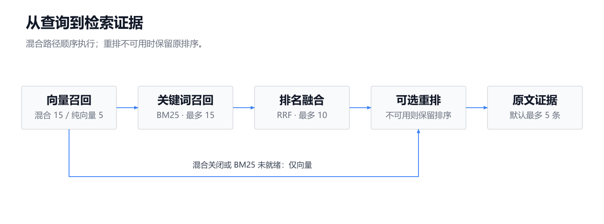
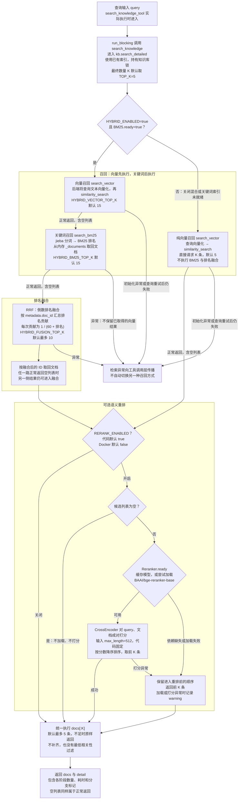
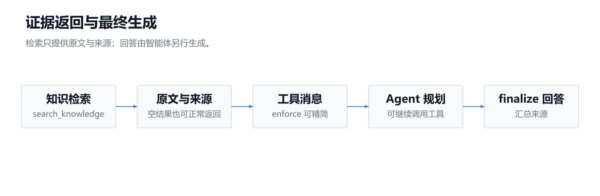
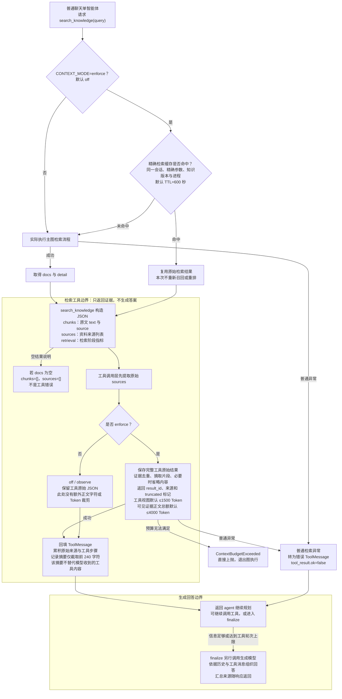

当前检索链是 **`search_knowledge → kb.search_detailed → 返回原文证据`**；生成回答由普通聊天智能体另行调用模型完成。

已核对相关实现，未修改代码、未读取 `.env`。下面数量均为代码默认值，不代表当前运行配置。

---

**主图：混合检索顺序执行，重排失败才明确保留原排序。**

<!-- readme-diagram:05-rag-retrieval-01 -->

展开原始完整流程

正常混合路径的数量关系是 **`最多15＋最多15 → 融合最多10 → 最终最多5`**。纯向量路径直接召回最多 5 条，再进行可选重排，没有额外扩大候选集。

源码：[retriever.py:275](../../../app/rag/retriever.py#L275)、[fusion.py:6](../../../app/rag/fusion.py#L6)、[lexical.py:50](../../../app/rag/lexical.py#L50)、[reranker.py:21](../../../app/rag/reranker.py#L21)。

---

**补图：检索证据如何返回智能体，以及上下文模式下的额外裁剪。**

<!-- readme-diagram:05-rag-retrieval-02 -->

展开原始完整流程

来源优先使用 `metadata.doc_id`，缺失时回退为 `标题#分块序号`。`enforce` 的模型结果视图最多保留 20 个来源，但图状态累积的是投影前提取的来源，最终再去重。

`enforce` 的裁剪与重排是两件事：前者限制模型可见证据，后者调整候选文档排序。超长代码片段可能被替换为补读提示，完整工具结果另存；存在补读线索时，智能体可使用 `read_tool_result`，单次结果默认最多 1000 Token（模型文本计量单位）。

源码：[tools.py:27](../../../app/agents/tools.py#L27)、[graph.py:163](../../../app/agents/graph.py#L163)、[evidence.py:23](../../../app/context/evidence.py#L23)、[tool_projection.py:43](../../../app/context/tool_projection.py#L43)、[tool_projection.py:105](../../../app/context/tool_projection.py#L105)。

---

**实际配置与固定参数：**

| 阶段 | 数量、开关及边界 |
|---|---|
| 最终数量 | `AIROBOT_TOP_K=5`；工具参数只有 `query`，没有对模型开放 `top_k` 参数 |
| 混合检索 | `AIROBOT_HYBRID_ENABLED=true`，还要求 `BM25.ready` |
| 混合路径向量召回 | `AIROBOT_HYBRID_VECTOR_TOP_K=15` |
| 关键词召回 | `AIROBOT_HYBRID_BM25_TOP_K=15`；BM25 的 `k1=1.5`、`b=0.75` 写死在代码中 |
| 排名融合 | `AIROBOT_HYBRID_FUSION_TOP_K=10`；RRF 平滑常数 `k=60` 是函数默认值，没有项目环境配置项，也没有融合权重配置 |
| 重排 | `AIROBOT_RERANK_ENABLED` 代码默认 `true`，Docker 默认 `false`；模型由 `AIROBOT_RERANK_MODEL` 指定 |
| 重排模型输入 | `CrossEncoder(max_length=512)` 写死，没有对应项目配置项 |
| 相关性过滤 | 本链路未设置向量最低分、重排最低分或 `score_threshold`；语义答案缓存的 `0.75` 门限不用于这里 |
| 向量调用重试 | 可重试异常默认最多尝试 3 次，含首次；后端初始化不在该查询重试包装内 |

配置依据：[config.py:121](../../../app/config.py#L121)、[config.py:152](../../../app/config.py#L152)、[resilience.py:18](../../../app/services/resilience.py#L18)、[Dockerfile:20](../../../Dockerfile#L20)。

这些数量限制针对**单次检索**，不是整次聊天的来源总数；智能体可进行多次工具调用。

---

**空结果与部分能力不可用的真实路径：**

| 情况 | 实际处理 |
|---|---|
| 混合检索关闭，或 BM25 没有可用倒排词项 | 走纯向量检索，跳过 BM25 和 RRF |
| 非 Milvus 后端且 `chunk_count=0` | `search_vector` 直接返回 `[]`，不调用向量服务 |
| Milvus 后端初始化成功，但集合不存在 | 向量召回返回 `[]`；这不同于连接失败或依赖缺失 |
| 向量正常返回 `[]`，BM25 有结果 | 混合流程继续，关键词结果可通过 RRF 返回 |
| BM25 正常返回 `[]`，向量有结果 | 混合流程继续，向量结果可通过 RRF 返回 |
| 向量调用抛错、Milvus 缺依赖或连接失败 | 异常上抛，不自动切换 BM25 或内存后端 |
| BM25 执行抛错 | 异常上抛，不使用已经取得的向量结果作回退 |
| 重排依赖缺失、模型加载或打分失败 | 保留重排前顺序，取前 K 条 |
| 最终结果为空 | 工具正常返回空证据，智能体继续规划；没有硬编码拒答 |
| `enforce` 证据预算不足 | 抛出预算异常，不伪装成空检索结果 |

`detail.rerank_enabled=true` 只表示进入了启用重排的分支，**不能证明模型实际加载或打分成功**。

`retriever.py` 虽然还定义了 `answer_with_rag` / `aanswer_with_rag` 这两个“检索后生成”的辅助函数，但当前普通聊天的 `search_knowledge` 工具链没有调用它们；上图的生成边界位于 [graph.py:231](../../../app/agents/graph.py#L231)，而不是检索工具内部。
