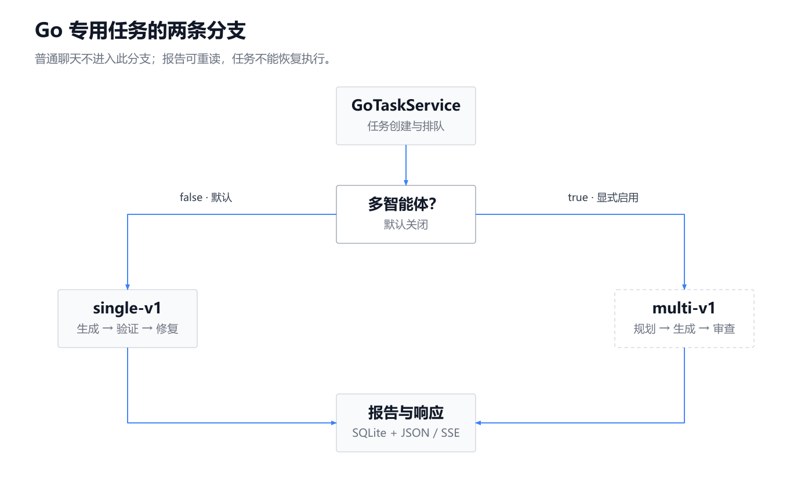
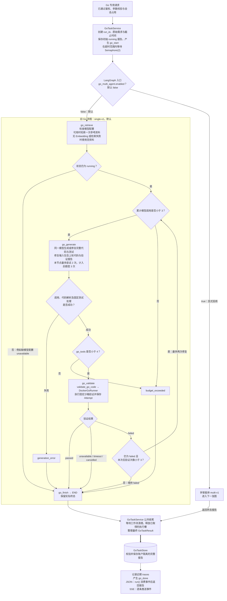
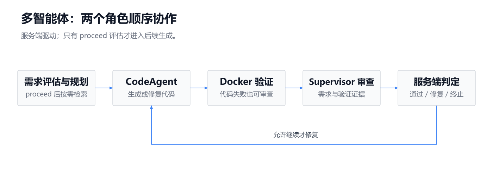
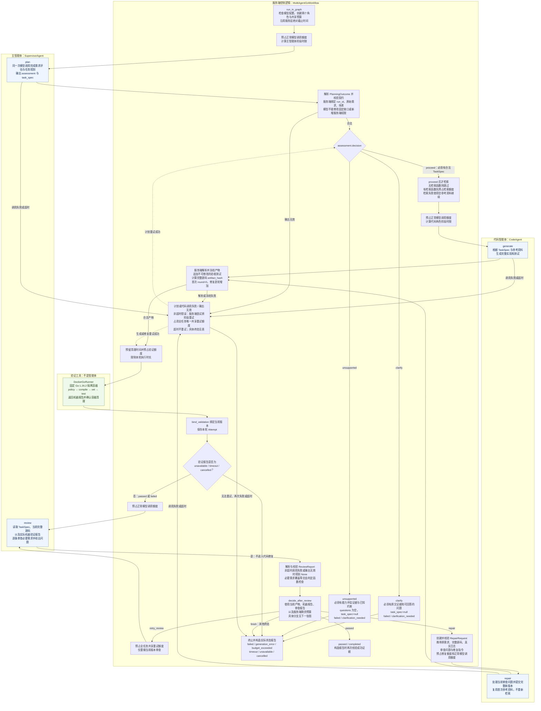
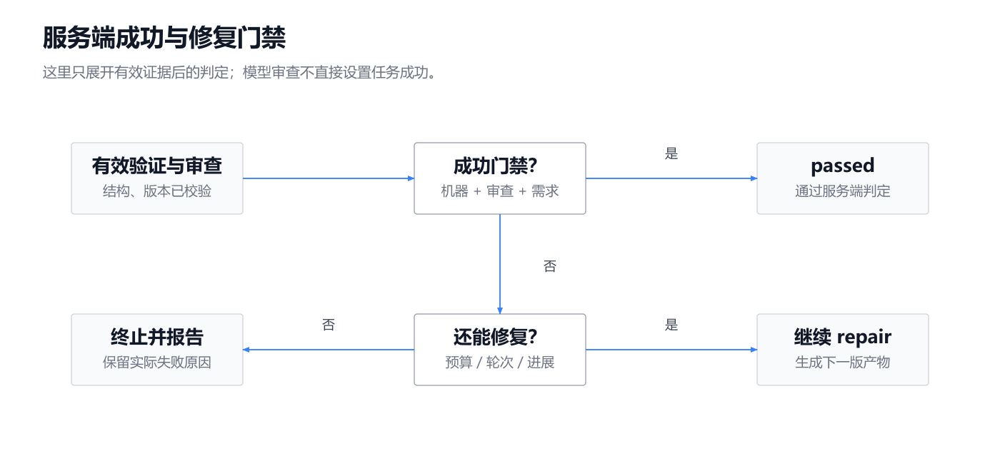
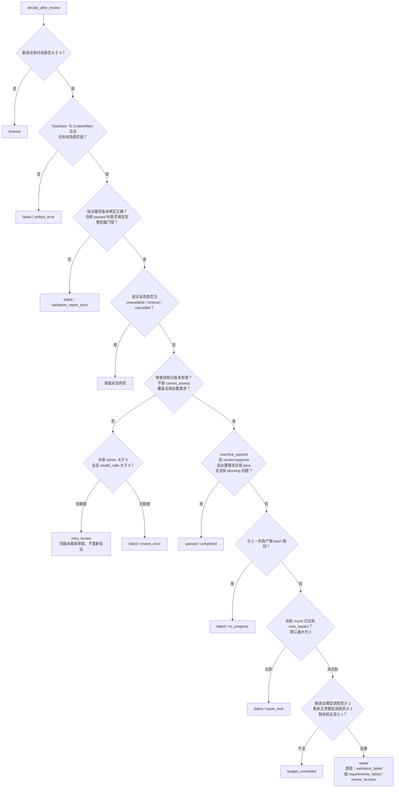

Go 专用任务由服务端按开关选择 **旧流程 `single-v1`** 或 **多智能体流程 `multi-v1`**；默认关闭多智能体，验证器始终是工具，最终成功由服务端判定。

以下基于当前源码，未修改代码、未读取 `.env`。实线表示执行顺序，虚线表示事件或异常后的恢复路径，粗线表示报告保存。

---

**主图：配置分支、旧 Go 流程与公共收尾。**

<!-- readme-diagram:06-go-orchestration-01 -->

展开原始完整流程

旧流程首次追加服务端验收测试，修复时保留首轮的固定验收文件；模型自己的测试可以更新。生成重试会消耗三次模型总额度，因此不保证一定有足够额度完成两次修复。

两种流程只属于 Go 专用入口。普通聊天没有 `go_request`，不会进入这些分支。

源码：[graph.py:272](../../../app/agents/graph.py#L272)、[service.py:76](../../../app/go_validation/service.py#L76)、[nodes.py:65](../../../app/go_validation/nodes.py#L65)、[nodes.py:94](../../../app/go_validation/nodes.py#L94)、[nodes.py:191](../../../app/go_validation/nodes.py#L191)。

---

**多智能体图：两个角色由服务端顺序驱动，验证工具不参与角色决策。**

<!-- readme-diagram:06-go-orchestration-02 -->

展开原始完整流程

这里有三个关键顺序：

- **先评估与规划，再检索。** 当前首次计划收到的参考资料为 `[]`；检索结果用于后续代码生成，修复复用已有资料。
- **机器验证失败也可以进入审查。** 只有验证环境不可用、验证超时或取消会直接结束，不让模型修复基础设施。
- **`clarify` 与 `unsupported` 都是当前任务终态。** 用户补充需求后需重新提交，生成新的 `run_id`；没有自动等待回复或恢复执行。

源码：[go_workflow.py:334](../../../app/agents/go_workflow.py#L334)、[go_workflow.py:358](../../../app/agents/go_workflow.py#L358)、[go_workflow.py:473](../../../app/agents/go_workflow.py#L473)、[supervisor.py:102](../../../app/agents/supervisor.py#L102)、[code_agent.py:87](../../../app/agents/code_agent.py#L87)。

---

**服务端判定图：先判断能否成功，再判断是否继续修复。**

<!-- readme-diagram:06-go-orchestration-03 -->

展开原始完整流程

多智能体成功需要同时满足：

1. 当前请求有合法的 `proceed` 评估，任务、场景和原始需求绑定一致。
2. 验证与审查对应同一个 `task_id / artifact_id / artifact_hash / round`。
3. `machine_passed`：状态为 `passed`，Go 版本正确，容器已清理；阶段严格为 `policy、compile、vet、test`，全部退出码为 0，日志未标记截断。
4. 审查为 `approve`，所有 `required=true` 的需求检查均为 `pass`，没有 `blocking` 问题。
5. 最终报告保留相符的产物、尝试和审查证据，并通过 `GoTaskResult` 校验；`GoTaskStore.save` 保存时再次执行报告校验。

审查证据是服务端判定的输入，主智能体没有直接把任务状态设置为成功的权限。

源码：[go_workflow.py:76](../../../app/agents/go_workflow.py#L76)、[go_workflow.py:89](../../../app/agents/go_workflow.py#L89)、[contracts.py:261](../../../app/go_validation/contracts.py#L261)、[contracts.py:273](../../../app/go_validation/contracts.py#L273)、[contracts.py:427](../../../app/go_validation/contracts.py#L427)、[store.py:26](../../../app/go_validation/store.py#L26)。

---

**预算与默认配置：**

| 项目 | 旧流程 `single-v1` | 多智能体 `multi-v1` |
|---|---|---|
| 默认选择 | 多智能体开关为 `false` 时使用 | `AIROBOT_GO_MULTI_AGENT_ENABLED=true` |
| 模型调用 | 总计最多 3 次，包含生成重试 | 正常调用默认 7 次；全任务共享异常重试 1 次；总计最多 8 次 |
| 修复与验证 | 最多修复 2 次、验证 3 次，仍受模型额度约束 | 默认最多修复 2 次、验证 3 次，可配置得更低 |
| 检索 | 一个检索阶段；工具计数从 1 开始，含验证最多 4 | 默认最多 1 次；无检索函数时跳过，有函数但额度为 0 时预占失败 |
| 总时间 | 服务层默认 360 秒 | 默认 360 秒，沿用服务层截止时间，排队时间计入 |
| 模型阶段时限 | 单次生成默认 120 秒 | 主角色默认 60 秒，代码角色默认 120 秒，均受剩余时间限制 |
| 验证与清理 | `DockerGoRunner` 默认执行 90 秒、清理 15 秒 | 执行默认最多 90 秒，并在剩余任务时间内预留 15 秒清理额度 |
| 模型输入限制 | 使用旧 Go 上下文适配逻辑 | 角色输入预算始终检查，不依赖实验 `CONTEXT_MODE` 是否开启 |
| 启用前置条件 | 无多角色窗口要求 | 两个角色窗口默认均为 0；开启时必须配置足够窗口，否则配置校验失败 |

正常调用额度 7 次对应：**计划 1 次＋首次生成及审查 2 次＋两轮修复及审查 4 次**。失败请求也消耗预占额度，不返还；共享重试不是每个角色各有一次。

配置和执行依据：[config.py:30](../../../app/config.py#L30)、[go_workflow.py:164](../../../app/agents/go_workflow.py#L164)、[role_runtime.py:118](../../../app/agents/role_runtime.py#L118)。

---

**异常与终止方式：**

| 情况 | 当前实际行为 |
|---|---|
| 计划、生成或修复发生非超时 `AgentError`，包括输出无效 | 服务端尝试预占共享重试额度，原阶段重试一次；重试仍失败为 `generation_error`；无法预占额度为 `budget_exceeded`，截止时间耗尽为 `timeout` |
| 审查调用或输出无效、`cannot_assess`、缺少必要需求检查 | 有共享重试与总模型额度时重审；否则 `failed / review_error`，不会直接生成修复代码 |
| 角色超时或总任务超时 | 多智能体直接 `timeout`，不使用共享重试修复超时 |
| 输入预算或调用、验证、修复额度不足 | `budget_exceeded`；截止时间不足则 `timeout` |
| 修复产物无进展 | 未通过成功门禁且与上一失败产物哈希相同，终止为 `failed / no_progress` |
| 修复次数用尽 | 当前产物仍未通过门禁，终止为 `failed / repair_limit` |
| 验证环境不可用、容器清理不能确认 | 终止为 `unavailable`，不进入代码修复 |
| Go 测试内部 8 秒超时 | 沙箱按代码验证 `failed` 处理，仍可能进入修复；不同于验证器或任务级 `timeout` |
| 客户端断开或任务取消 | 等待工作流与容器清理，保存 `cancelled` 报告并重新传播取消，不保证发送 `go_done` |
| 报告构造、最终持久化等再抛异常 | 仍可能沿接口异常路径退出，不能保证所有错误都产生正常终态事件 |

旧流程的单次生成超时被生成节点当作调用失败处理，可占用剩余额度再试；尝试失败最终是 `generation_error`。它与多智能体的角色超时处理不同。

两种流程的任务报告通常仍通过 HTTP 200 返回，业务状态放在报告中；报告可按账户重新读取，**不能据此恢复任务执行**。
