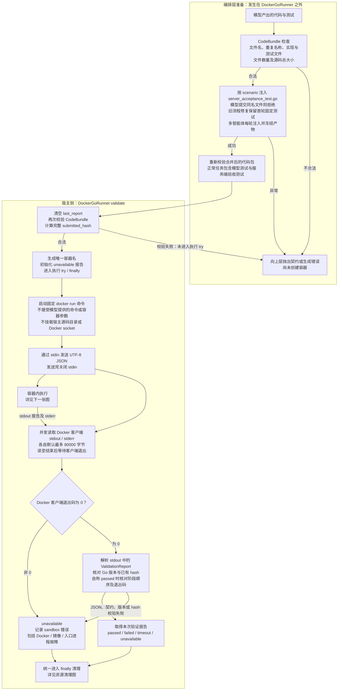
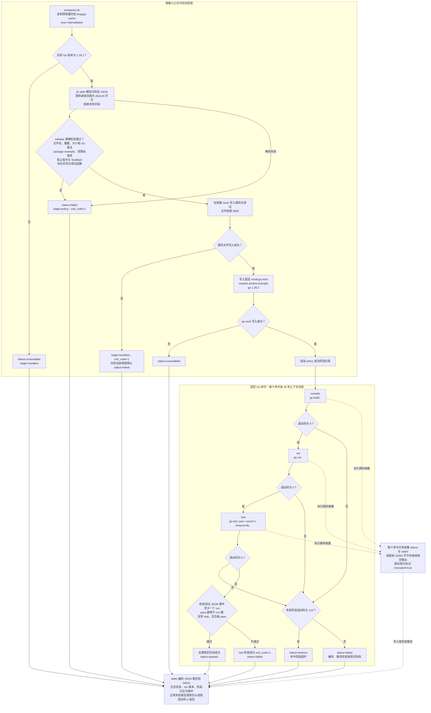
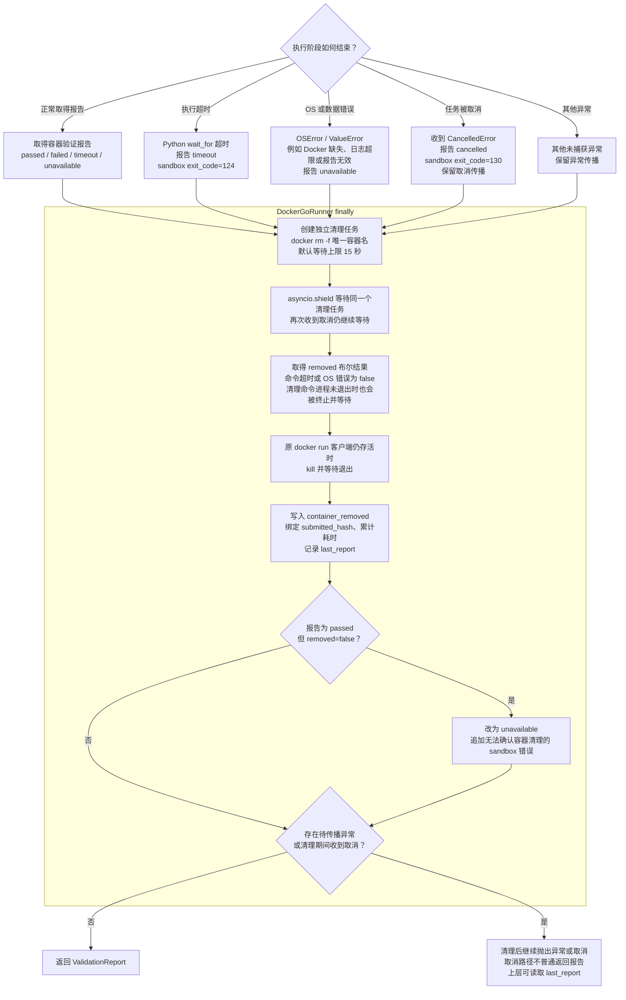

Go 沙箱验证把**已注入验收测试的代码包**送入固定 Docker 容器，依次执行策略检查、编译、静态检查和测试，收集报告后再确认资源清理。

已核对 Python 适配器、验收测试、镜像配置和容器内执行器。未修改代码、未读取 `.env`。

---

**主图：验收测试在编排层注入，临时源码文件只在容器内创建。**

<!-- readme-diagram:07-go-sandbox-01 -->

展开原始完整流程

`DockerGoRunner` 和直接调用的 `validate_go_code` **不会自动注入验收测试**；正常 Go 任务在调用它们之前完成注入。宿主侧没有创建临时源码目录，源码通过标准输入传输。

固定验收测试覆盖：

| 场景 | 注入测试的主要行为 |
|---|---|
| `context_cancel` | 已取消、等待后取消、截止时间传播 |
| `worker_pool` | 结果及顺序、输入不变、非法 workers、取消、空任务 |
| `channel` | 求和及关闭、空 channel、nil channel 取消、已取消上下文 |

源码：[fixtures.py:66](../../../app/go_validation/fixtures.py#L66)、[contracts.py:44](../../../app/go_validation/contracts.py#L44)、[contracts.py:261](../../../app/go_validation/contracts.py#L261)、[runner.py:56](../../../app/go_validation/runner.py#L56)。

---

**容器内流程：检查顺序严格为 `policy → compile → vet → test`，失败即停止后续阶段。**

<!-- readme-diagram:07-go-sandbox-02 -->

展开原始完整流程

策略检查使用 AST（语法树）解析源码，实际包含：

- 2～8 个 Go 文件，名称不区分大小写去重，源码 UTF-8 总字节数最多 64 KiB。
- 所有文件属于 `package example`；至少有实现文件和 `Test` 开头的顶层测试函数。
- 导入路径必须属于镜像生成的标准库清单，并排除 `unsafe`、`syscall`、`os/exec`、`plugin`。
- 拒绝包含 `go:` 或以 `//line ` 开头的相应注释，拒绝 `TestMain`。

代码没有在 AST 阶段证明“每个测试都含有效断言”；固定验收测试和测试运行结果承担后续检查。

源码：[runner.go:68](../../../sandbox/go/runner.go#L68)、[runner.go:92](../../../sandbox/go/runner.go#L92)、[runner.go:162](../../../sandbox/go/runner.go#L162)、[runner.go:188](../../../sandbox/go/runner.go#L188)。

---

**资源清理图：进入执行 `try` 后，各种退出路径都会尝试清理，但清理结果必须单独确认。**

<!-- readme-diagram:07-go-sandbox-03 -->

展开原始完整流程

客户端断开需先由接口层转化为任务取消；`DockerGoRunner` 本身不监听 HTTP 连接。取消后它先完成清理、写入 `last_report`，再传播取消；多智能体适配层会据此绑定并保存取消验证记录。

`container_removed=false` 不表示已经安全清理完毕。只有原状态为 `passed` 时，代码会因此降级为 `unavailable`；其他失败状态保留原状态，同时携带清理标记。

源码：[runner.py:36](../../../app/go_validation/runner.py#L36)、[runner.py:101](../../../app/go_validation/runner.py#L101)、[go_workflow.py:414](../../../app/agents/go_workflow.py#L414)。

---

**实际隔离与资源限制：**

| 范围 | 当前配置 |
|---|---|
| 镜像与工具链 | 固定 `airobot-go-validator:1.26.2`；基础镜像固定摘要，`--pull=never`，运行时不自动拉镜像 |
| 网络 | `--network=none`；`GOPROXY=off`、`GOSUMDB=off`、`GOTOOLCHAIN=local` |
| 权限 | UID/GID `65532:65532`，删除全部 capabilities，`no-new-privileges` |
| 根文件系统 | `--read-only`；没有宿主源码目录或 Docker socket 挂载 |
| 临时存储 | `/tmp` 为 384 MiB tmpfs，显式允许执行；`/work` 为 16 MiB tmpfs；均带 `nosuid,nodev` |
| CPU 与内存 | `--cpus=1`；内存 512 MiB，`memory-swap=512m` |
| 进程与文件描述符 | `pids-limit=128`，`nofile=256:256` |
| Go 执行环境 | `CGO_ENABLED=0`、`GOMAXPROCS=2`、`GOFLAGS=-p=1`；工作目录固定 `/work` |
| 命令时间 | 每个 Go 命令使用 35 秒上下文；`go test` 内部另有 8 秒测试超时 |
| 外层时间 | Python 执行默认 90 秒；清理命令另有默认 15 秒，不应把 90 秒理解为含清理的总耗时 |
| 日志 | 每个 Go 阶段合并保留前 16384 字节；宿主分别限制 stdout、stderr 各 80000 字节 |

只读根文件系统不等于禁止所有文件读取：代码仍可读取容器内有权限访问的文件。网络和文件系统边界由容器配置落实，不应画成“禁止导入所有网络或文件操作包”。

镜像依据：[Dockerfile](../../../sandbox/go/Dockerfile)、[entrypoint.sh](../../../sandbox/go/entrypoint.sh)、[runner.py:23](../../../app/go_validation/runner.py#L23)。

---

**不同失败类型及“通过”的边界：**

| 情况 | 验证状态与后续 |
|---|---|
| 策略、编译、`vet` 或测试失败 | `failed`，停止后续阶段，保留已完成阶段的报告，然后清理 |
| `go test` 内部 8 秒超时 | 属于测试失败，状态为 `failed`，编排层仍可能修复代码 |
| 单个 Go 命令 35 秒超时 | 阶段退出码改为 124，验证状态为 `timeout` |
| Python 外层执行超时 | `timeout`，尝试强制删除容器并终止客户端 |
| Docker 不可用、镜像缺失、入口进程非零退出 | `unavailable`；不会退到宿主执行源码 |
| 宿主管道日志超过 80000 字节或报告无效 | `unavailable`，进入同一清理路径 |
| 容器内阶段日志被截断 | 标记 `truncated=true`，并非一律立刻失败；测试事件不完整会失败，多智能体成功门禁还会拒绝任何阶段截断 |
| 客户端取消所引发的任务取消 | 清理后传播取消；任务层保存 `cancelled`，不保证再发送终止事件 |

**沙箱通过只说明当前代码包的规定检查通过且容器清理已确认。** 正常 Go 任务还受编排层约束：

- 旧流程主要依据本轮验证报告决定是否通过。
- 多智能体流程还要求合法 `proceed` 评估、同一版本的验证与审查绑定、主智能体 `approve`、必要需求全部通过、没有 `blocking` 问题，并通过最终报告契约校验。

验证器既不是独立智能体，也不能单独决定整个多智能体任务最终成功。对应门禁见 [go_workflow.py:76](../../../app/agents/go_workflow.py#L76)、[go_workflow.py:89](../../../app/agents/go_workflow.py#L89)、[contracts.py:427](../../../app/go_validation/contracts.py#L427)。
