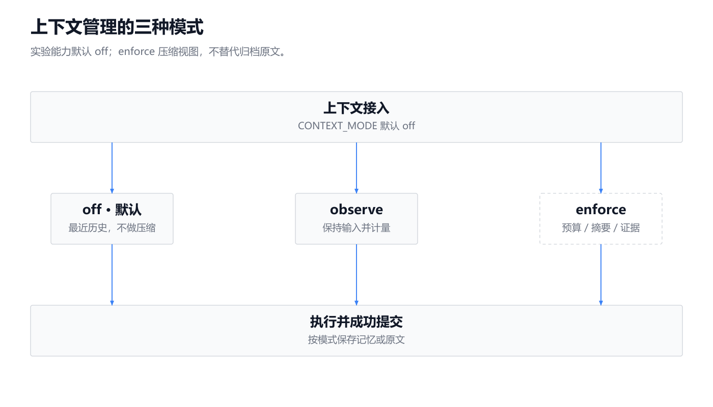
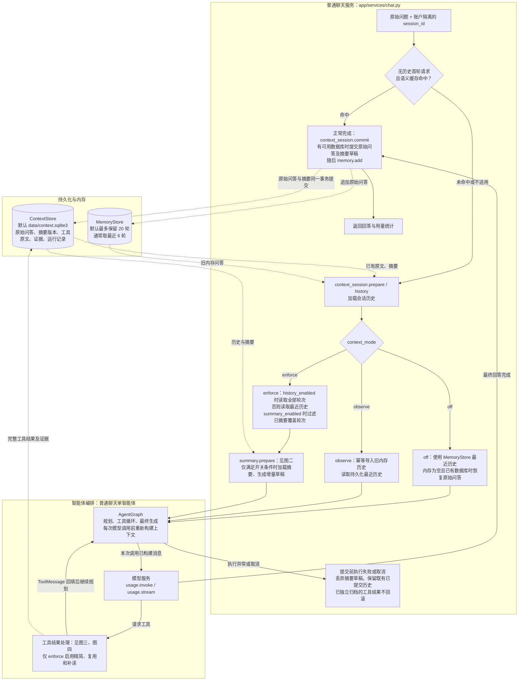
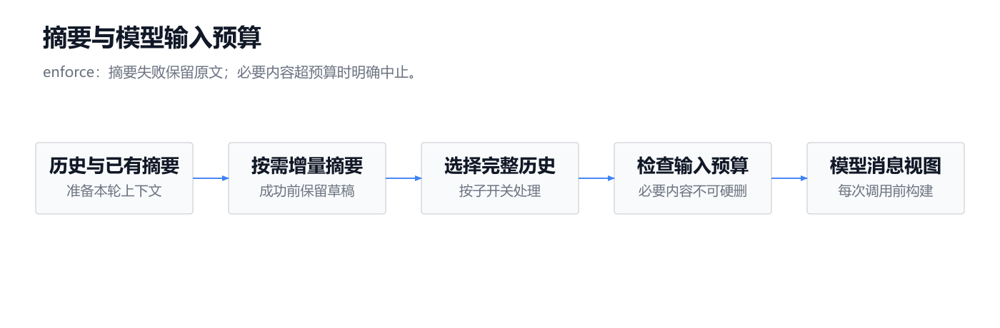
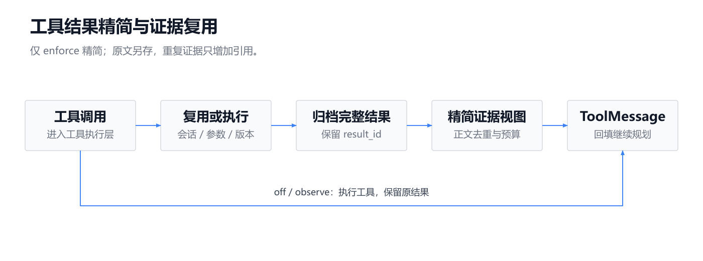
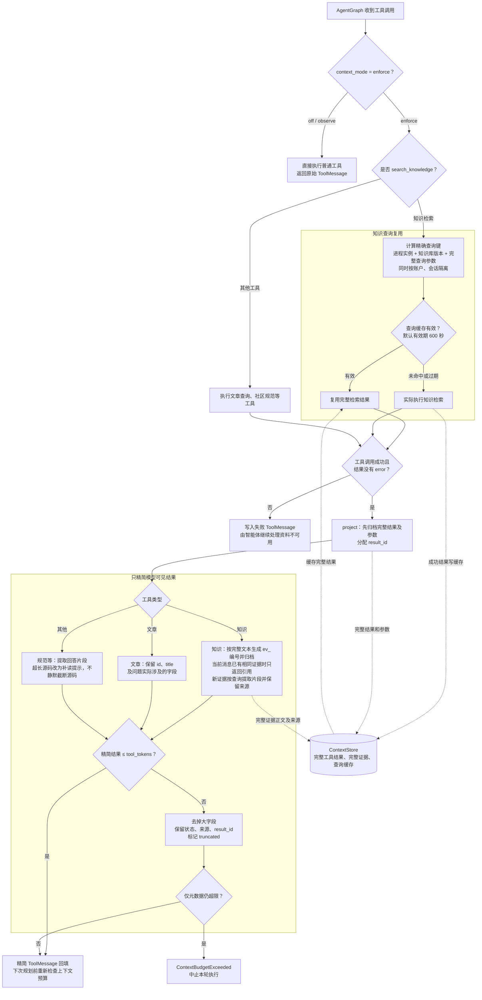
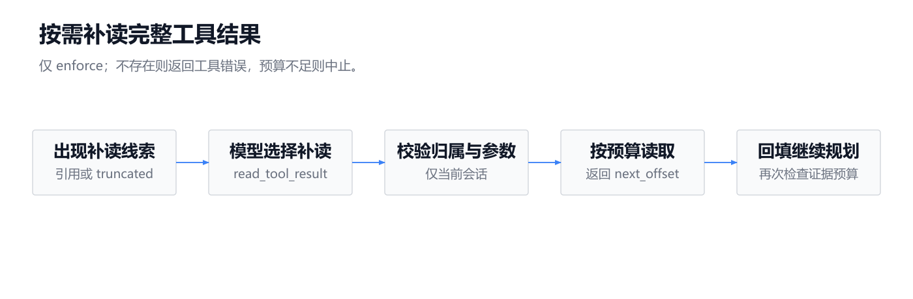
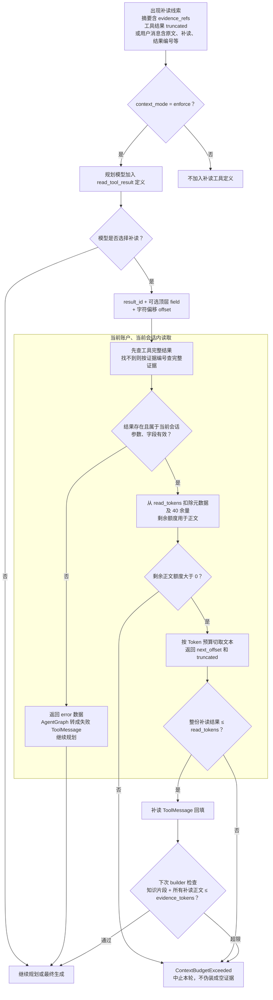

上下文管理在模型调用前构造受预算约束的输入，并保留已归档原文；这套实验能力默认关闭。

以下默认值来自源码，未读取 `.env`，也未用历史评测推断当前运行状态。各图实线表示执行顺序，虚线表示数据读写。

| 模式 | 普通聊天的实际行为 |
|---|---|
| `off`，默认 | 不进行上下文压缩；使用最近历史。公共 `usage` 层仍计算输入估算、记录模型用量 |
| `observe` | 保持原模型输入，记录估算并持久化原始问答；不生成摘要、不精简工具结果 |
| `enforce` | 启用预算检查、工具精简、证据复用和补读；历史管理、增量摘要还受各自子开关控制 |

`context_history_enabled=true`、`context_summary_enabled=true` 是子开关默认值，**不意味着默认启用**。`enforce` 还要求配置足够的模型窗口和有效计数校准，否则应用启动失败。

源码：[配置默认值](../../../app/config.py#L130)、[启动校验](../../../app/main.py#L36)、[校准条件](../../../app/context/token_counter.py#L22)。

---

**一、主图：普通聊天接入与原始数据保留**

<!-- readme-diagram:08-context-management-01 -->

展开原始完整流程

关键边界：

- 摘要准备发生在进入图之前，**不会在每次工具循环后重新生成摘要**；消息构建发生在每次规划及最终生成之前。
- `off` 且数据库不存在时，不主动创建上下文数据库；已有数据库时仍可恢复、继续写入原始问答。
- `observe/enforce` 可幂等导入当前内存中的旧问答，但无法恢复此前已被内存上限淘汰的内容。

源码：[聊天接入](../../../app/services/chat.py#L45)、[会话加载及提交](../../../app/context/session.py#L9)、[规划调用](../../../app/agents/graph.py#L132)、[最终生成](../../../app/agents/graph.py#L231)。

---

**二、增量摘要与最终消息构建**

此图展开 `enforce`；`off/observe` 的 `builder.build` 直接返回原输入，`observe` 额外记录前后相同的估算值。

```mermaid
flowchart TD
    subgraph SummaryPreparation["请求开始时：增量摘要"]
        PreparedState["本轮原始问题 + 已加载历史"]
        SummaryGate{"history_enabled<br/>且 summary_enabled？"}
        LoadSummary["读取上一版摘要<br/>加载尚未被摘要覆盖的已提交原始轮次"]
        TriggerGate{"未覆盖历史的估算量<br/>达到 history_tokens × 0.9？"}
        SelectOldTurns["从最旧完整轮次开始选取<br/>尽量让剩余历史降至 history_tokens × 0.7"]
        Summarize["模型增量整理<br/>上一版摘要 + 选中原文 + 合法证据编号<br/>每轮请求最多 2 次摘要调用，每次超时默认 30 秒"]
        ValidateSummary{"摘要契约和来源校验通过？<br/>轮次、约束撤销、证据归属、长度"}
        SummaryRetry{"还有摘要调用额度？"}
        SummaryDraft["保存摘要草稿<br/>当前执行状态改为：剩余历史 + 原始本轮消息<br/>持久化原始历史不删除"]
        SummaryFallback["保留原摘要及全部原文<br/>继续交给 builder 判断能否安全容纳"]
        UnchangedState["保留当前状态<br/>不新增摘要"]
    end

    subgraph MessageBuilding["每次模型调用前：builder.build"]
        Prefix["构造前缀<br/>系统指令 + 可用摘要<br/>摘要作为 HumanMessage 历史资料，不具有系统权限"]
        RequiredCheck{"摘要未超额度？<br/>工具调用与返回协议完整？<br/>当前可见证据未超总额度？"}
        HistoryGate{"history_enabled？"}
        SelectHistory["从新到旧选择完整的用户/助手消息对<br/>同时满足历史上限及整体输入上限"]
        KeepHistory["保留已加载历史"]
        CoverageGate{"省略了历史且 summary_enabled<br/>但摘要未覆盖被省略范围？"}
        Assemble["组合最终消息<br/>系统前缀 + 摘要 + 选中历史<br/>+ 本轮原始问题 + 完整工具调用组"]
        CountInput["TokenCounter 计算完整请求<br/>包含角色、内容、工具定义、调用及返回编号"]
        TotalGate{"校准有效且<br/>总输入估算不超过有效输入上限？"}
        ModelInput["交给模型的临时消息视图"]
        BudgetError["抛出 ContextBudgetExceeded<br/>不继续删除必须内容来强行发送"]
    end

    PreparedState --> SummaryGate
    SummaryGate -->|是| LoadSummary --> TriggerGate
    SummaryGate -->|否| UnchangedState
    TriggerGate -->|否| UnchangedState
    TriggerGate -->|是| SelectOldTurns --> Summarize --> ValidateSummary
    ValidateSummary -->|通过| SummaryDraft
    %% 摘要缺少合法证据、来源无效或长度超限，也进入候选修复
    ValidateSummary -->|失败| SummaryRetry
    Summarize -->|调用失败或超时| SummaryRetry
    SummaryRetry -->|有额度：反馈候选及校验错误| Summarize
    SummaryRetry -->|无额度| SummaryFallback

    UnchangedState --> Prefix
    SummaryDraft --> Prefix
    SummaryFallback --> Prefix
    Prefix --> RequiredCheck
    RequiredCheck -->|否| BudgetError
    RequiredCheck -->|是| HistoryGate
    HistoryGate -->|是| SelectHistory --> CoverageGate
    HistoryGate -->|否| KeepHistory --> Assemble
    %% 关闭摘要时允许按历史预算省略；开启摘要时禁止丢弃未覆盖历史
    CoverageGate -->|是| BudgetError
    CoverageGate -->|否| Assemble
    Assemble --> CountInput --> TotalGate
    TotalGate -->|通过| ModelInput
    TotalGate -->|失败| BudgetError
```

<!-- readme-diagram:08-context-management-02 -->

展开原始完整流程

预算是**分项上限加整体上限**，不是预先占满的固定分区：

| 项目 | 代码默认值或计算方式 |
|---|---|
| 整体输入上限 | `min(16000, context_model_window - 本次输出预留 - 2048)` |
| 普通聊天输出预留 | `4096` |
| 历史上限 | `6000` |
| 摘要上限 | `1000`；候选校验要求渲染正文不超过 `1000 - 64` |
| 可见证据总量 | `4000`，计入知识片段正文及补读正文 |
| 单次工具精简结果 | `1500`，包含结果元数据 |
| 单次补读结果 | `1000`，包含结果元数据 |

`TokenCounter` 使用 `tiktoken`、请求序列化、校准系数及额外 `32` Token（模型处理文本的计量单位）开销，得到本地估算；它不是供应商的精确计费数字。默认模型窗口为 `0`、校准路径为空，因此不能只把模式改成 `enforce` 就启动。

还有一个需要准确保留的条件差异：`history()` 在 `enforce && summary_enabled` 时过滤已覆盖轮次；但已有摘要的加载及增量生成要求 `enforce && history_enabled && summary_enabled`。不能假设关闭历史管理后，仍会自动补入已有摘要。

源码：[摘要准备](../../../app/context/summary.py#L110)、[摘要来源及约束校验](../../../app/context/summary.py#L47)、[消息构建](../../../app/context/builder.py#L43)、[预算计算](../../../app/context/budget.py#L7)、[原文与摘要事务提交](../../../app/context/store.py#L51)。

---

**三、工具结果精简与证据复用**

<!-- readme-diagram:08-context-management-03 -->

展开原始完整流程

知识新片段的正文预算为：

`max(0, min(context_tool_tokens // 2, 剩余证据预算))`

默认每片段最多按 `750` Token 提取，但还必须满足整份工具结果 `1500` 和累计证据 `4000` 的限制。证据预算不足时可省略片段、保留补读入口；若必要元数据本身也放不下，则明确失败。

这里有两种不同复用：

- **查询复用**：相同会话、进程、知识库版本和参数的检索结果缓存，默认有效期 `600` 秒。
- **正文去重**：当前工具消息已有相同证据正文时，只增加证据引用及来源。`600` 秒不是证据原文的自动删除期限。

源码：[工具接入及错误处理](../../../app/agents/graph.py#L163)、[查询缓存与证据编号](../../../app/context/evidence.py#L15)、[工具精简](../../../app/context/tool_projection.py#L43)。

---

**四、受限原文补读及异常路径**

<!-- readme-diagram:08-context-management-04 -->

展开原始完整流程

- 补读没有独立的“最多读取几次”配置；它共享普通聊天默认 **4 轮工具调用**上限，一轮可含多个工具调用。
- `offset/next_offset` 是字符偏移；预算用 Token 计算。重复补读正文仍累计占用证据预算。
- 摘要引用不存在的证据会使摘要候选校验失败；补读时证据不存在则返回工具错误，**不会自动重新检索或等待资料恢复**。
- 普通聊天预算异常：JSON 返回 HTTP `422 / context_budget_exceeded`；已建立的 SSE（服务端持续推送事件）连接发送对应 `error`，随后发送 `done`。取消会向上传播并清理摘要草稿。

源码：[补读实现](../../../app/context/tool_projection.py#L105)、[可见证据计量](../../../app/context/evidence.py#L49)、[补读工具绑定](../../../app/agents/graph.py#L140)、[JSON 异常映射](../../../app/main.py#L104)、[SSE 错误及清理](../../../app/services/chat.py#L291)。

---

**五、Go 任务的实际接入范围**

普通聊天使用上述单智能体流程，不自动进入 Go 多智能体流程。Go 专用入口按多智能体开关分流，默认关闭。

| 路径 | 上下文接入与保留方式 | 不足时如何处理 |
|---|---|---|
| 旧 Go 流程，默认路径 | 不加载聊天历史、聊天摘要。`enforce` 下检索结果经过 `project`；`go_adapter` 深拷贝生成输入，压缩成功阶段日志、提取失败测试关键信息，保留完整必要源码及验收文件。其他模式参考资料使用原有 `16000` 字符裁剪 | 适配器检查使用输出预留 `8192`；预算不足返回 `budget_exceeded` |
| Go 多智能体，可选 | 不接入聊天的 `session.history / summary.prepare / builder.build / read_tool_result`。按任务结构重新构建角色消息；代码角色在修复时复用首轮资料。参考资料上限 `16000` 字符，每阶段日志上限 `8000` 字符，源码完整传递 | 角色输入预算检查独立于 `context_mode`；超限抛出 `BudgetExceededError(kind="context")`，任务结束为 `budget_exceeded` |

多智能体角色默认输入上限均为 `16000`，主角色输出预留 `4096`、代码角色 `8192`、安全余量 `2048`；启用时必须配置足够的角色模型窗口。另外，公共 `usage.invoke` 在全局 `enforce` 下还会追加整体上下文检查；其异常由角色运行时按调用失败处理，不能全部画成角色预算异常。

源码：[Go 入口分流](../../../app/agents/graph.py#L276)、[旧 Go 检索及生成](../../../app/go_validation/nodes.py#L65)、[Go 上下文适配器](../../../app/context/go_adapter.py#L11)、[多智能体检索](../../../app/agents/go_workflow.py#L374)、[角色输入检查](../../../app/agents/role_runtime.py#L118)、[代码角色资料复用](../../../app/agents/code_agent.py#L97)、[公共调用检查](../../../app/context/usage.py#L138)。
