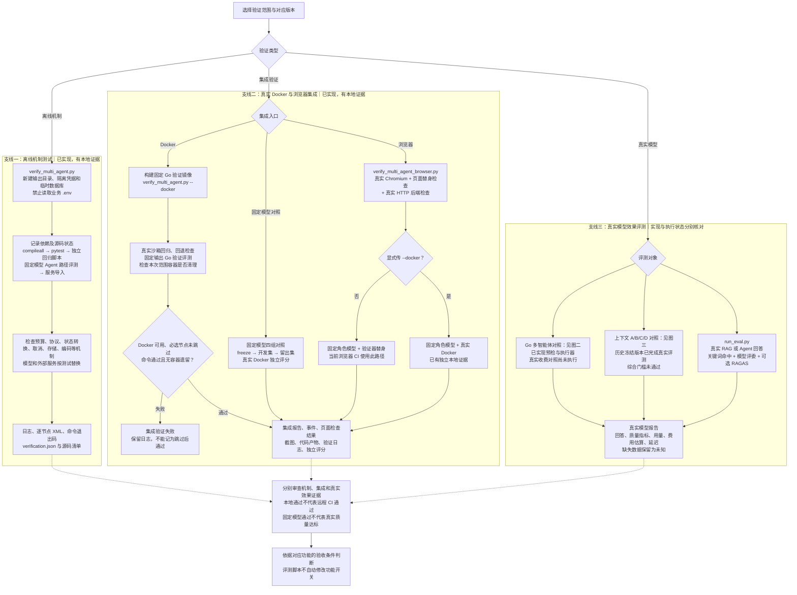
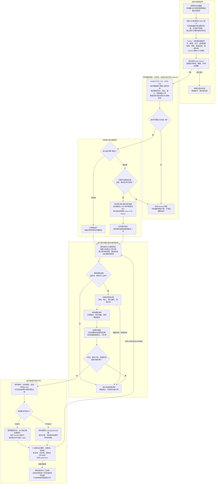
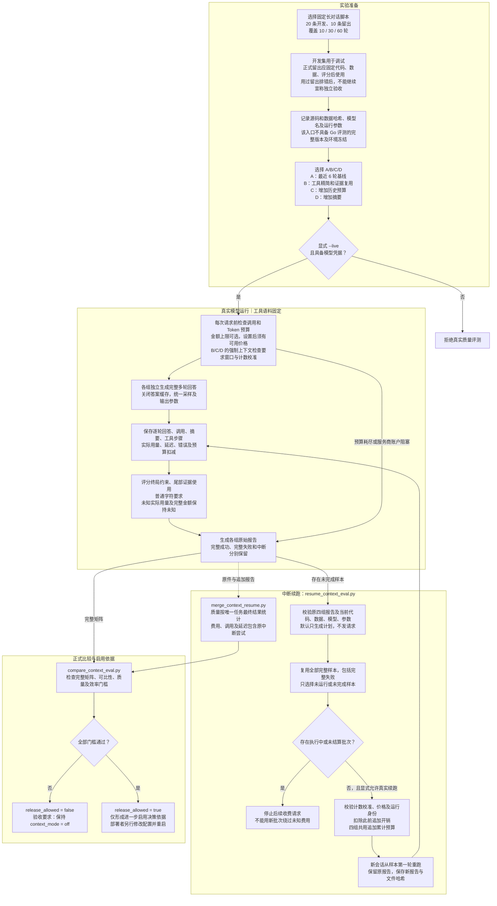

项目通过机制测试、集成验证和真实模型评测分别检查“实现是否正确、组件能否协作、实际效果是否达标”，最终启用仍需人工依据验收结果修改配置。

先修正两处文档与代码差异：

- `docs/development.md` 的 CI（持续集成）章节已过时。当前实际任务为 `offline`、`go-validation`、`browser`、`live-evaluation-policy`，最后一个只输出提示，**不执行收费评测**。
- 浏览器 CI 使用真实 Chromium 和 HTTP 后端，但未传 `--docker`，验证器仍使用替身；本地另有“浏览器＋真实 Docker”的证据。

依据：[当前 CI](../../../.github/workflows/ci.yml#L17)、浏览器脚本（本地参考：`scripts/verify_multi_agent_browser.py:12`）、[测试后端](../../../scripts/multi_agent_dashboard_server.py#L21)。

---

**一、主图：三条验证支线**

实线表示执行流程，虚线表示报告、证据的汇总关系。三条支线并非所有脚本共享的一条强制流水线。

<!-- readme-diagram:09-verification-evaluation-01 -->

展开原始完整流程

CI 实际依赖关系为：

| 任务 | 实际内容 |
|---|---|
| `offline` | Windows/Ubuntu × Python 3.11/3.13；隔离离线验证 |
| `go-validation` | 等待 `offline`；Linux 真实 Docker、固定模型开发/留出对照 |
| `browser` | 等待 `offline`；真实 Chromium，但未开启真实 Docker 验证器 |
| `live-evaluation-policy` | 独立提示任务，不运行真实模型，不判断质量是否通过 |

离线模式允许明确跳过 Docker 节点；`--docker` 验收要求节点实际运行，缺节点或出现跳过会判失败。

源码：隔离验证入口（本地参考：`scripts/verify_multi_agent.py:15`）、[固定模型 Agent 路径评测](../../../eval/run_agent_eval.py#L20)、[CI Docker 对照](../../../.github/workflows/ci.yml#L45)。

---

**二、Go 多智能体：冻结、真实评测、独立评分与费用结算**

<!-- readme-diagram:09-verification-evaluation-02 -->

展开原始完整流程

关键边界：

- 固定模型四组对照采用同类冻结、留痕及独立 Docker 评分流程，但不请求收费模型。固定角色会读取样本标签，因此只能验证机制。
- `native` 对照同时改变调用资源；`equal3` 只对齐调用上限，不能声称实际调用、费用或修复机会相同。
- Go 评测没有自动恢复任务内部执行。中断目录保留；再次运行使用新目录及来源、原因，继续使用原累计费用账本。未知调用不能退款或补零。
- 协议已声明留出误批准为零、质量不下降、延迟与数值成本目标；执行器实现了预检和指标汇总，**没有自动汇总这些目标并开启功能的逻辑**。

源码：[冻结与数据校验](../../../eval/multi_agent_protocol.py#L71)、[真实预检](../../../eval/multi_agent_protocol.py#L220)、[费用账本](../../../eval/multi_agent_protocol.py#L156)、[调用记录及结算](../../../eval/run_multi_agent_eval.py#L50)、[开发/留出限制](../../../eval/run_multi_agent_eval.py#L252)、[独立评分](../../../eval/multi_agent_scoring.py#L102)。

---

**三、上下文：真实四组对照、中断续跑与自动门槛**

<!-- readme-diagram:09-verification-evaluation-03 -->

展开原始完整流程

上下文比较器实际要求：

| 类别 | 已实现的门槛 |
|---|---|
| 可比性 | 四组条件一致，每组完整 `30 × 3` 次 |
| 质量 | 非劣性下界不低于 `-3%`；硬约束、尾部证据 `100%`；普通字符约束至少 `98%`；D 组留出全部通过 |
| 用量 | 实际用量完整；已知调用的输入估算无低估 |
| 效率 | 长对话输入至少节省 `20%`；重复请求不增加；P95（95% 请求不超过的耗时）增幅不超过 `10%`；完整费用不增加 |

这里的开发/留出边界部分依靠实验纪律：`run_context_eval.py` 支持选择 `split`，但**不强制要求先提交完整开发报告**。续跑工具才会严格核对原报告和冻结身份。

源码：[四组执行与评分](../../../eval/run_context_eval.py#L87)、[请求前预算保护](../../../app/context/usage.py#L17)、[续跑约束](../../../eval/resume_context_eval.py#L149)、[合并统计](../../../eval/merge_context_resume.py#L66)、[正式门槛](../../../eval/compare_context_eval.py#L55)。

---

**四、哪些已有证据，哪些仍未验证**

本次只读取代码、文档和已有报告并核对哈希，没有重新执行测试、浏览器、Docker 或收费模型。

| 项目 | 实现与已有证据 | 结论边界 |
|---|---|---|
| 离线机制验证 | 2026-10-19 本地记录：`337 passed`，63 个 Docker 节点明确跳过 | 不能记为 Docker 全通过 |
| 真实 Docker 全套 | 同日本地记录：`400 passed`、无跳过；回退及容器清理检查通过 | 本地证据，不是远程 CI 成绩 |
| 浏览器集成 | 已有固定模型下的验证器替身、真实 Docker 两类本地记录 | 不证明真实模型效果 |
| Go 固定模型对照 | 开发 72 次、留出 48 次，共 120 次；300 次固定客户端调用 | 机制对照，不是模型质量结果 |
| Go 真实模型对照 | 预检和执行器已实现；现有预检为 `blocked`、`calls_sent=0` | 真实质量、费用及推理延迟仍未验证 |
| 上下文真实对照 | 历史冻结版本完成 360 次，报告 `release_allowed=false` | 质量和效率综合门槛未通过；其记录源码有 3 处与当前代码不同 |
| 远程 CI | 工作流已实现；仓库验收记录标为未运行 | 尚无匹配提交的远程通过证据 |

本次核对，多智能体本地冻结清单的 **107 个文件与当前清单完全一致**；这不代替重新验证运行环境。上下文旧报告则不能直接认证当前代码。

证据：本地修复验收（本地参考：`docs/multi-agent-remediation-results.md:23`）、多智能体冻结（本地参考：`docs/evidence/remediation-20261019/freeze-mechanism-v3.json`）、真实模型预检（本地参考：`docs/evidence/remediation-20261019/live-preflight.json`）、上下文正式比较（本地参考：`eval/reports/context/final-resumed-v3/comparison.json`）、[上下文验收结论](../../context-management-final-results.md)。

补充两个入口差异，避免把统一预算保护画到所有脚本上：

- `run_eval.py` 使用关键词、LLM-as-Judge（用模型给回答评分）和可选 RAGAS；门槛参数默认不设置，RAGAS 指标没有通过阈值。`--no-ragas` 仍调用模型评委，且该入口没有 Go 评测的累计费用账本。
- `calibrate_context_counter.py` 会发送 20 次真实计量请求；它验证计数估算，不验证回答质量，也不共享 Go 费用预检。

对应源码：[RAG 评测及可选门槛](../../../eval/run_eval.py#L222)、[计数校准](../../../scripts/calibrate_context_counter.py#L17)。

当前代码默认仍为多智能体 `false`、上下文 `off`。启动代码检查配置合法性，**不会读取验收报告自动允许或阻止启用**；报告结论与人工部署决策必须在图中分开。
