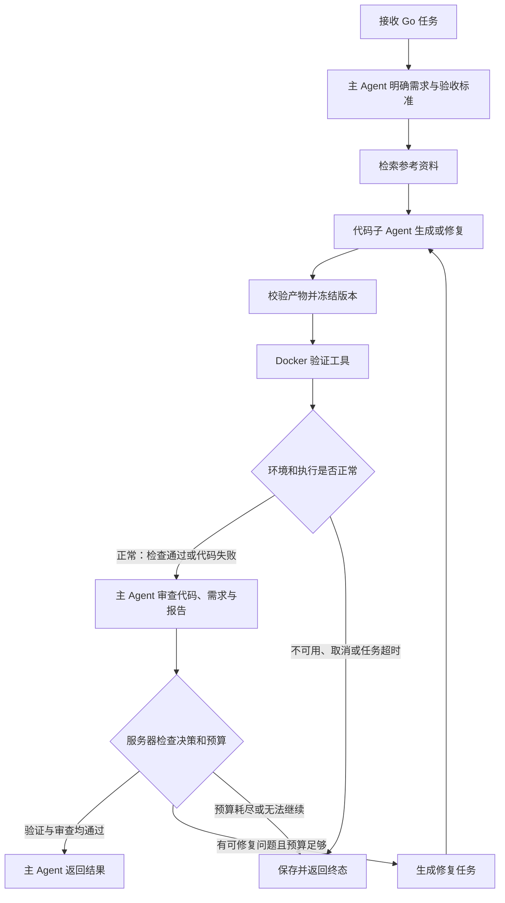

# 主 Agent 与代码子 Agent 实施计划表

编制日期：2026-10-17。代码基线：`1ea7e6b`。状态：S0–S9 已有实际执行记录，原表保留设计目标；当前完成、待验证、阻塞以 [S9 逐项核对](multi-agent-delivery-audit.md) 为准，不能将设计目标当作已实现能力。

目标：用户提交 Go 示例需求后，主 Agent 明确任务并委派代码子 Agent；子 Agent 生成代码和测试，工具执行隔离验证，主 Agent 审查实现与验证证据；存在可修复问题时返回具体修复任务，直到通过或达到停止条件。

本计划适用于 `AI-Robot-latest`。旧目录未提交的多 Agent 实现需要先评估可复用部分，再逐项迁移；不能直接覆盖新版生成、验证与上下文代码。

**第一版范围**

| 项目 | 约定 |
| --- | --- |
| Agent 数量 | 1 个主 Agent、1 个代码子 Agent；Docker 验证器作为工具 |
| 主 Agent | 管理任务、组织需求和验收标准、审查结果、形成修复指令和最终说明 |
| 代码子 Agent | 使用独立提示词和任务上下文，完成生成、补充测试及修复，返回完整代码产物 |
| 执行方式 | 继续使用 LangGraph；代码子 Agent 封装为子图或可调用组件，主图管理交接与路由 |
| 支持场景 | 延续 context_cancel、worker_pool、channel；标准库、单包、现有文件数量及大小限制 |
| 模型选择 | 首先使用同一模型区分角色，配置允许分别指定主 Agent 和代码 Agent 模型 |
| 接入入口 | 第一版通过现有 Go 任务 JSON/SSE 接口；普通聊天自动识别并委派代码任务安排在后续版本 |
| 修复次数 | 首次生成后最多 2 轮修复；每次代码变化都重新验证和审查 |
| 上下文 | 子 Agent 只接收当前任务必要信息；实验性上下文管理保持独立开关，不能成为多 Agent 必需前提 |
| 完成条件 | 同一份代码的沙箱验证通过、主 Agent 审查通过，且没有未解决的阻断问题 |

**阶段计划表**

以下工作量按一名熟悉项目的开发者、模型服务和 Docker 可用估算；不包含外部服务等待时间。总计约 8–12 个工作日，具体排期在基线检查后调整。

| 阶段 | 核心工作 | 交付物 | 前置条件 | 估算 | 完成门槛 |
| --- | --- | --- | --- | --- | --- |
| P0 基线与范围 | 检查现有代码、测试和旧本地改动；固定首版范围 | 基线记录、复用清单、差异清单 | 无 | 0.5 日 | 现有能力、已知失败和环境缺项可追溯 |
| P1 契约与状态 | 定义任务、产物、审查、反馈、预算和终态 | 数据契约、状态流转表 | P0 | 1–1.5 日 | 所有成功、修复、异常出口定义清楚 |
| P2 两个 Agent | 实现主 Agent 和代码子 Agent，建立独立上下文 | Agent 组件、提示词、模型配置 | P1 | 1–1.5 日 | 可用固定模型分别验证委派、生成和审查 |
| P3 闭环编排 | 接入沙箱、审查、修复路由和停止条件 | 可运行的多 Agent 工作流 | P2 | 1.5–2 日 | 完成一次通过、修复通过、最终失败三条主路径 |
| P4 接口与存储 | 统一 JSON/SSE、持久化审查和角色用量 | API 扩展、报告兼容、事件记录 | P3 | 1–1.5 日 | 流式和非流式结果一致、旧报告可读取 |
| P5 控制台 | 展示委派、代码版本、审查问题和修复进度 | Dashboard 和浏览器验收 | P4 | 1 日 | 用户能理解当前阶段及通过或失败原因 |
| P6 测试与评测 | 机制测试、真实 Docker、模型对照评测 | 测试结果、对照报告、问题清单 | P3–P5 | 1–2 日 | 功能与预算门槛满足，效果结论有证据 |
| P7 文档与启用 | 使用说明、默认开关、回退演练 | 文档、验收记录、启用建议 | P6 | 0.5–1 日 | 配置明确、回退可行、限制已记录 |

**逐项执行计划表**

每项开始时记录基线，结束时记录文件、验证命令和结果；存在失败时记录原因，不能只勾选“完成”。以下为原始任务定义；初始状态已被 [交付核对](multi-agent-delivery-audit.md) 的当前状态取代。

| 编号 | 具体任务 | 主要文件或产物（新增路径为拟定） | 依赖 | 验收标准 |
| --- | --- | --- | --- | --- |
| T01 | 固定提交、依赖版本、当前测试结果和 Docker 可用性 | 基线记录 | 无 | 明确已通过、失败、跳过及未运行项 |
| T02 | 检查旧目录的 multi_agent.py 和相关测试，逐项判断复用 | 旧实现复用清单 | T01 | 每项列明可复用逻辑、接口差异和取舍；保留旧目录原件 |
| T03 | 确定第一版角色、三个场景、接口及运行边界 | 本计划与状态表 | T01 | 首版无需扩展多包、第三方依赖或开放式命令执行 |
| T04 | 定义 TaskSpec、CodeArtifact、ReviewReport、RepairRequest | app/go_validation/contracts.py | T03 | 字段类型、长度、枚举与关联 ID 有校验 |
| T05 | 定义状态及确定性路由规则 | app/agents/go_workflow.py | T04 | LLM 不能绕过失败验证、修复上限和终态规则 |
| T06 | 定义角色配置、共享预算、超时和开关 | app/config.py、.env.example | T04 | 非法值启动拒绝；所有角色及重试计入总预算 |
| T07 | 实现主 Agent 的任务分解与委派 | app/agents/supervisor.py | T04、T06 | 原始需求可追溯，固定接口不被改写，未明确要求不被擅自增加 |
| T08 | 封装代码子 Agent 和任务内状态 | app/agents/code_agent.py | T04、T06 | 独立上下文；接收首次任务或修复任务；输出完整实现与测试 |
| T09 | 复用围栏代码解析、产物校验和服务端验收测试注入 | app/go_validation/nodes.py、fixtures.py | T08 | 非法文件拒绝；固定服务端测试每轮一致；模型测试可修复 |
| T10 | 实现主 Agent 审查提示词及结构化输出 | app/agents/supervisor.py | T07、T09 | 审查覆盖需求、接口、边界和测试；问题有定位、依据及修复建议 |
| T11 | 建立最小上下文交接与产物版本校验 | 两个 Agent 组件、contracts.py | T08、T10 | 审查绑定当前 artifact_hash；过期报告不被接受；必要源码不被静默截断 |
| T12 | 接入主图和 Go 子流程，保留选择入口 | app/agents/graph.py、go_workflow.py | T05、T09、T10 | 开关可选择原流程或新流程；普通问答路径回归通过 |
| T13 | 接入现有 Docker 验证器与错误分类 | app/go_validation/runner.py、tools.py | T12 | 编译/测试失败进入审查；环境不可用和整体超时停止 |
| T14 | 实现修复任务及问题状态跟踪 | supervisor.py、go_workflow.py | T11–T13 | 修复包含原需求、上版完整代码、失败日志及问题 ID；解决情况可追溯 |
| T15 | 实现调用预算、截止时间和无进展停止 | go_workflow.py、service.py、app/context/usage.py | T06、T14 | 重试也扣预算；达到上限停止；相同失败产物不无限循环 |
| T16 | 扩展 GoTaskService 的角色注入和结果组装 | app/go_validation/service.py | T15 | 测试可独立注入主模型、子模型、检索器和验证器 |
| T17 | 扩展 JSON/SSE 数据与阶段事件 | app/main.py、contracts.py、service.py | T16 | 终态业务字段一致；原事件可用；客户端可忽略新增字段 |
| T18 | 保存任务计划、代码版本、审查与修复历史 | app/go_validation/store.py、contracts.py | T17 | 旧 JSON 报告通过默认字段读取；新增内容按账户隔离 |
| T19 | 完善取消、异常及清理后的持久化 | service.py、runner.py | T17、T18 | 生成、审查、验证阶段均可取消；保存已有产物和已发生调用 |
| T20 | 展示主 Agent 委派与子 Agent 工作阶段 | app/static/dashboard.html | T17 | 阶段名称、轮次和角色清晰；断流不显示为成功 |
| T21 | 展示审查问题、代码差异、预算和最终结论 | dashboard.html、scripts/test_multi_agent_dashboard.cjs | T18、T20 | 阻断与建议分开；代码与日志按文本显示；历史报告可查看 |
| T22 | 编写正常与失败闭环的离线测试 | tests/test_multi_agent_workflow.py | T15–T19 | 覆盖首次通过、修复后通过、修复耗尽和环境终止 |
| T23 | 编写审查可信性与契约测试 | tests/test_multi_agent_contracts.py、test_multi_agent_review.py | T10、T11 | 覆盖误批准、格式错误、陈旧 hash、越权测试改动、需求遗漏 |
| T24 | 验证 API 一致性、账户隔离、取消和预算 | tests/test_multi_agent_http.py、test_multi_agent_budget.py | T17–T19 | JSON/SSE 一致；跨账户不可读；超限后无额外模型或 Docker 调用 |
| T25 | 运行真实 Docker 验收和原业务回归 | 现有 Go 测试及新增场景 | T22–T24 | 所需环境具备时沙箱测试实际运行；原问答和文章集成无新增回归 |
| T26 | 固定对照数据、评分规则和费用上限 | eval/multi_agent_cases.jsonl、eval/run_multi_agent_eval.py | T23、T25 | 单流程与多 Agent 使用同一数据、模型及预算；开发集与留出集分开 |
| T27 | 执行固定模型测试及有预算的真实模型评测 | eval/reports/multi_agent/ | T26 | 两种评测分开报告；完整保存失败、耗时、角色用量和未知用量 |
| T28 | 整理结果、更新操作说明、演练开关回退 | docs/multi-agent.md、README.md、CI | T21、T25、T27 | 功能是否完成、效果是否改善分别给结论；旧流程和旧报告可用 |

**Agent 之间的数据契约**

| 契约 | 建议字段 | 约束 |
| --- | --- | --- |
| TaskSpec | task_id、scenario、original_requirement、requirements、acceptance_criteria、constraints、source_refs | 每条需求分配稳定 ID；服务端接口和限制优先；不能静默弱化用户需求 |
| CodeArtifact | artifact_id、artifact_hash、round、files、change_summary、addressed_issue_ids | hash 由服务端根据规范化文件名和完整内容计算；不能由模型自报 |
| ValidationReport | artifact_hash、status、stages、elapsed_ms、container_removed | 来源于实际验证器；绑定当前完整产物；保留现有阶段日志和退出码 |
| ReviewIssue | issue_id、requirement_id、severity、file、line、evidence、repair_instruction | severity 为 blocking 或 suggestion；文件和行号需与产物匹配；允许整体设计问题无单行定位 |
| ReviewReport | artifact_hash、verdict、requirement_checks、issues、summary | verdict 为 approve、revise、cannot_assess；approve 与 blocking 问题同时出现属于非法报告 |
| RepairRequest | task_spec、previous_artifact、validation_report、review_report、remaining_budget | 同时带机器错误和需求问题；问题列表必须绑定当前轮次 |
| TaskResult 扩展 | workflow_version、task_spec、reviews、agent_calls、stop_reason、final_summary | 新字段提供兼容默认值；旧 attempts 和 status 含义保留 |

代码内容沿用现有围栏输出再解析校验，避免将大量源码强制嵌入模型输出的 JSON 字符串。审查和任务说明采用结构化对象。主 Agent 的计划与审查属于同一角色的不同步骤；代码子 Agent 的生成与修复共享当前任务内的必要状态，各任务之间隔离。

**通过、修复和停止规则**

| 情况 | 动作 | 对外结果 |
| --- | --- | --- |
| 验证 passed，当前版本审查 approve，所有必要需求明确通过 | 完成并生成最终说明 | passed |
| 编译、vet 或测试失败，代码可修复且预算足够 | 主 Agent 整理错误与修复要求，调用子 Agent | running，进入下一轮 |
| 验证 passed，但主 Agent 发现阻断性需求问题 | 附带证据返回修复；不得仅因测试通过结束 | running，进入下一轮 |
| 主 Agent approve，但机器验证失败 | 服务端拒绝通过，按失败项修复或停止 | running 或 failed |
| 只有非阻断建议 | 可以通过，在结果中保留建议 | passed |
| 审查 cannot_assess、输出非法或引用过期代码 | 在共享重试额度内重新审查；仍不可判断则停止 | failed，stop_reason=review_error |
| 用户要求与场景固定接口冲突或关键需求无法确定 | **设计未实现**：clarification_needed 仅有枚举，标准闭环尚无可达返回路径 | T05 待验证/有实现缺口 |
| 修复两轮后仍存在代码或需求问题 | 保存每轮代码及未解决问题 | failed |
| 达到总调用或上下文额度 | 停止后续委派及验证 | budget_exceeded |
| Docker/镜像不可用，或沙箱级整体超时 | 直接结束；代码级测试超时按现有验证器分类处理 | unavailable 或 timeout |
| 用户取消或 SSE 连接断开 | 取消活动调用，清理容器，保存已有进度 | cancelled |
| 子 Agent 在仍有阻断问题时返回完全相同的代码 | 终止无进展循环，保留审查依据 | failed，stop_reason=no_progress |

通过判定必须由服务端执行：`validation.status == passed && review.verdict == approve && requirements_complete && blocking_issues == 0 && artifact_hash_matched`。模型输出“通过”仅是一个输入条件。

**第一版预算建议（待评测校准）**

| 项目 | 初始建议 | 计量规则 |
| --- | --- | --- |
| 业务轮次 | 首次生成 + 最多 2 次修复 | 最多 3 份进入验证的代码版本 |
| 正常模型调用 | 计划 1 次 + 生成最多 3 次 + 审查最多 3 次 | 正常路径最多 7 次；提前通过即结束 |
| 共享异常重试 | 全任务最多 1 次 | 用于格式错误或可恢复调用失败；不能各角色分别额外重试 |
| 总模型调用 | 最多 8 次，含失败请求和重试 | 发送前占用额度；SDK 隐式重试关闭；最终说明优先复用最终审查摘要 |
| 资料检索 | 默认最多 1 次 | 修复复用已有资料，记录实际执行次数和来源 |
| 沙箱验证 | 最多 3 次 | 每个有效代码版本一次；修复后必须重新验证 |
| 总时间 | 初始沿用 360 秒，并配置化 | 包含排队、计划、生成、审查、验证和必要清理；阶段使用剩余截止时间 |
| 单次调用 | 代码生成上限 120 秒；主 Agent 上限 60 秒；验证上限 90 秒 | 实际上限取阶段上限和剩余任务时间中较小者 |
| 模型上下文 | 按实际角色模型窗口配置输入和输出额度 | 必要源码放不下时明确停止；未知计数不能声称有精确 Token 硬上限 |
| 费用 | 分别记录主 Agent、子 Agent、检索和失败请求 | 单价或实际用量不完整时标记未知；真实评测执行前设置累计费用上限 |

这些上限独立生效，并不保证在 360 秒内能够完成所有 8 次调用。对照评测采用相同总预算；如果业务希望延长新流程截止时间，应另列实验组，避免把更多预算带来的收益归因于多 Agent。

**验收矩阵**

| 编号 | 验收场景 | 预期结果 |
| --- | --- | --- |
| A01 | 首次代码与审查均通过 | 只生成一次，不进入修复 |
| A02 | 编译失败后修复成功 | 下一轮收到真实编译错误，修改后重新验证和审查 |
| A03 | 测试通过但需求遗漏 | 主 Agent 指出对应需求 ID，修复后补测 |
| A04 | 两轮修复仍失败 | 3 个版本完整保留，终态 failed |
| A05 | 审查错误批准失败代码 | 服务端拒绝 passed |
| A06 | 审查基于前一版源码 | hash 校验失败，不接受陈旧结论 |
| A07 | 子 Agent 尝试改服务端验收测试 | 拒绝或恢复可信测试，不能削弱验收条件 |
| A08 | 审查超时、格式错误或无法判断 | 限次重试后返回明确失败，无无限循环 |
| A09 | 审查仅提出风格建议 | 建议展示但不强制触发修复 |
| A10 | 日志或检索资料夹带指令 | 保持数据边界，模型不能改变执行权限和预算 |
| A11 | Docker 不可用或沙箱异常 | 终止，不浪费模型调用反复改代码 |
| A12 | 任意阶段取消、整体超时 | 任务终止、资源清理、已有报告可查 |
| A13 | 模型请求失败或解析重试 | 调用数包含这些请求；无超额调用 |
| A14 | JSON 与 SSE 执行同样任务 | 业务结果一致；事件顺序和最终状态正确 |
| A15 | 跨账户读取报告、并发相同会话 | 延续账户隔离及会话占用规则 |
| A16 | 服务升级后读取旧报告 | 新字段补默认值，旧报告正常展示 |
| A17 | 子 Agent 返回相同失败代码 | 及时停止并说明无进展 |
| A18 | 关闭新流程开关 | 原 Go 流程可运行，普通问答回归通过 |

离线测试使用固定模型和验证器替身检查机制；真实 Docker 用例验证实际代码执行。真实模型评测另行报告，不能用固定输出的通过率替代模型能力。

**效果评测计划**

| 项目 | 设计 |
| --- | --- |
| 对照组 A | 当前单生成模型 + Docker 验证 + 最多两轮修复 |
| 实验组 B | 主 Agent 计划/审查 + 代码子 Agent + 相同 Docker 验证 |
| 样本 | 建议先制作 30 条任务，三个场景各 10 条；每场景 6 条开发、4 条留出，总计 18/12 |
| 重复次数 | 预算允许时每组每任务独立运行 3 次，共 180 个任务运行；先小样本验证采集链路 |
| 特殊覆盖 | 超出固定服务端测试覆盖的用户补充约束、取消行为、顺序、输入不变、测试缺陷、不可完成需求 |
| 公平性 | 同一模型、相同数据与任务时间/调用总上限；记录实际模型版本、参数及每次运行配置 |
| 质量指标 | 独立验收通过率、需求满足率、误批准率、误拒绝率、修复成功率、停止原因 |
| 效率指标 | 全流程 P50/P95、角色调用次数、已知 Token、未知用量调用数、费用估算 |
| 独立评分 | 用主 Agent 不可修改的测试和固定需求检查表评分；审查 Agent 的 approve 不作为真实正确性的标签 |
| 结果解释 | 保留失败和中断结果，报告样本量及不确定性；证据不足时仅说明机制完成，不宣称质量提升 |
| 启用条件 | 机制验收通过，原功能无新增回归，留出集无已知误放行且质量不下降；费用及延迟符合评测前确定的目标 |

费用和延迟目标需要在小样本实测后、正式留出集评测前固定。多 Agent 默认作为可选流程，只有对照结果支持时才考虑扩大启用。

**里程碑与交付记录**

| 里程碑 | 必须具备的证据 | 当前状态（S9） |
| --- | --- | --- |
| M1 设计可实施 | P0/P1 完成，契约和路由规则经检查 | 见 S9 核对 |
| M2 闭环可运行 | 固定模型跑通首次通过、修复通过、失败终止 | 见 S9 核对 |
| M3 产品可使用 | API、报告、Dashboard 和取消流程验收完成 | 见 S9 核对 |
| M4 效果可判断 | 真实 Docker 及对照评测报告，保留所有失败记录 | 阻塞：真实模型未运行，固定条件没有改善 |
| M5 可交付 | 文档齐全、配置与回退演练完成、启用结论明确 | 见 S9 核对 |

每个任务的执行记录使用：`编号 / 状态 / 变更文件 / 验证命令 / 结果 / 剩余问题`。状态使用待执行、进行中、待验证、完成、阻塞，并将阻塞原因写明。

设计依据：现有 `app/agents/graph.py`、`app/go_validation/`、`app/context/usage.py`、Go 工作流测试，以及 [LangChain Subagents](https://docs.langchain.com/oss/python/langchain/multi-agent/subagents) 和 [LangGraph Subgraphs](https://docs.langchain.com/oss/python/langgraph/use-subgraphs) 官方文档。
